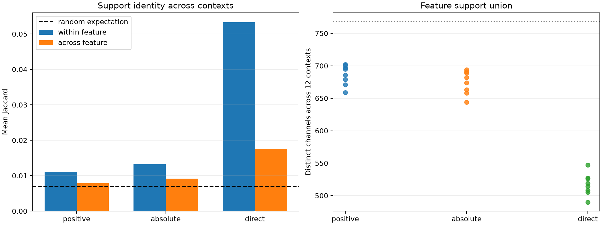

# How stable are the dynamic semantic coalitions?

This is a post-hoc reuse audit of the 64-channel supports that were already selected and causally tested. It does not add a new preregistered success claim. Pairwise Jaccard overlap is compared within versus across semantic labels, and feature labels are permuted across the fixed support-overlap matrix as a null.

A uniformly random rank-64 support among 4,608 channels has expected pairwise Jaccard **0.0070**.

| Support | Within median / mean | Across median / mean | Mean gap | Permutation p | Median union | Median ≥half core |
|---|---:|---:|---:|---:|---:|---:|
| local_positive64 | 0.0079/0.0111 | 0.0079/0.0078 | +0.0032 | 0.0005 | 690 | 0 |
| local_absolute64 | 0.0079/0.0133 | 0.0079/0.0092 | +0.0041 | 0.0005 | 678 | 0 |
| local_direct64 | 0.0492/0.0534 | 0.0159/0.0176 | +0.0358 | 0.0005 | 516 | 4 |

## Reading the result

The successful suffix-conditioned positive coalitions are almost completely reselected for each context: their median within-feature overlap equals the random-scale overlap, each feature uses roughly 680 distinct channels across only twelve contexts, and no channel appears in half the contexts for any feature. A small above-null mean overlap exists, but it is not a stable neuron core.

The direct Down×unembedding supports are different: they have visibly higher within-feature than across-feature overlap and small recurring cores. Yet those stable weight-defined supports were much weaker causal controllers. This separates two objects: a relatively stable output-role scaffold in the weights, and a highly context-dependent subset that actually has leverage after the remaining sixteen layers.

That is evidence for input-conditioned coalitions, not evidence that the model literally stores a named feature as a fixed set of 64 neurons. The selected coalition is also objective-dependent: changing the output contrast changes the suffix gradient and therefore the support.
