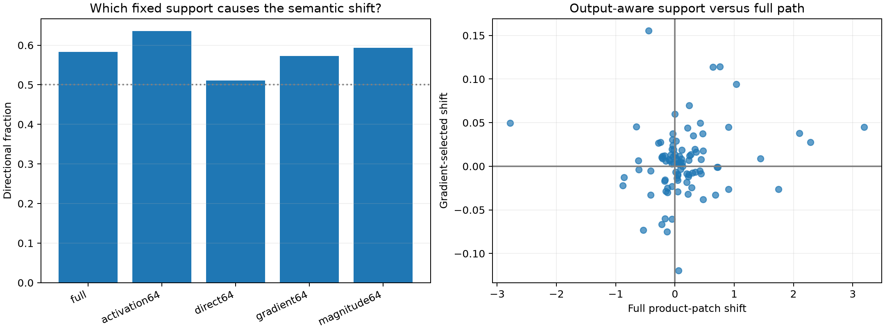

# Output-aware supervised coalitions

The same frozen 96 held-out donor–recipient pairs are rerun. Activation-only supports use feature predictivity. Direct supports additionally use the exact layer-1 Down weights and the raw unembedding class direction. Suffix-gradient supports use four disjoint discovery states per feature and differentiate the final clipped class score through layers 2–17. No held-out intervention outcome enters either fixed support.

## Locked hypotheses

- **W0_suffix_gradient_improves_direction: not supported.**
- **W1_suffix_gradient_improves_effect: not supported.**
- **W2_direct_weight_path_helps: not supported.**
- **W3_suffix_gradient_tracks_full_path: not supported.**
- **W4_output_aware_effect_generalizes: supported.**
- **W5_selection_is_discovery_only: supported.**

| Method | Directional all / uniform | Mean shift | Mean abs | Corr. with full |
|---|---:|---:|---:|---:|
| full | 0.583 / 0.562 | +0.1467 | 0.3889 | 1.000 |
| activation64 | 0.635 / 0.583 | +0.0114 | 0.0315 | 0.218 |
| direct64 | 0.510 / 0.458 | +0.0018 | 0.0272 | 0.252 |
| gradient64 | 0.573 / 0.688 | +0.0053 | 0.0265 | 0.142 |
| magnitude64 | 0.594 / 0.542 | +0.0250 | 0.1002 | 0.504 |

## Interpretation

If suffix sensitivity improves selection, activation selectivity and output use are distinct parts of a feature explanation. If it does not, a fixed average gradient is itself too coarse: downstream use may be input-conditioned, or the feature may travel mostly outside this MLP path.
