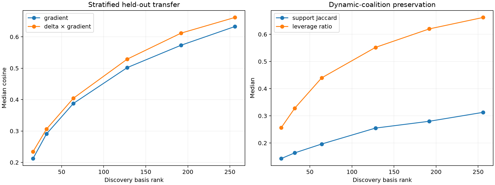

# Position-stratified suffix-gradient subspace

One discovery gradient is collected for each of eight semantic objectives at every one of the 32 evaluated sequence positions. The resulting 256-gradient span is tested on the previously frozen 96 held-out gradients and activation deltas.

## Locked hypotheses

- **K0_rank64_transfer: not supported.**
- **K1_rank128_transfer: not supported.**
- **K2_rank256_transfer: not supported.**
- **K3_rank256_contribution_transfer: not supported.**
- **K4_rank256_support_transfer: not supported.**
- **K5_rank256_leverage_transfer: not supported.**
- **K6_stratification_materially_improves_rank32: not supported.**

Random rank-256 projection cosine: **0.235**.

| Rank | Gradient cosine | Q10 | Contribution cosine | Support Jaccard | Leverage ratio |
|---:|---:|---:|---:|---:|---:|
| 16 | 0.212 | 0.151 | 0.234 | 0.143 | 0.257 |
| 32 | 0.291 | 0.233 | 0.306 | 0.164 | 0.328 |
| 64 | 0.388 | 0.336 | 0.404 | 0.196 | 0.440 |
| 128 | 0.502 | 0.456 | 0.529 | 0.255 | 0.552 |
| 192 | 0.573 | 0.539 | 0.612 | 0.280 | 0.620 |
| 256 | 0.633 | 0.608 | 0.662 | 0.313 | 0.662 |

## Guardrail

The evaluation gradient is still projected to obtain coefficients, so this is a basis-existence test. It cannot establish a forward-state router even if the span transfers.
