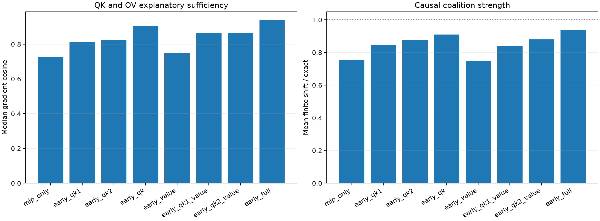

# Early suffix attention-factor pilot

For attention responses in Blocks 2–9, the exact local VJP is split into first-QK, second-QK, and current-value/OV derivatives. Each program composes its selected derivative families through the native MLP and residual VJPs, then selects and finitely patches its own top-64 Layer-1 channels.

Maximum local QK1+QK2+value recomposition error: `8.37e-08`.

## Locked hypotheses

- **M0_factor_vjps_recompose_native_attention: supported.**
- **M1_full_early_factor_program_replicates: supported.**
- **M2_qk_routing_alone_is_sufficient: supported.**
- **M3_value_transport_alone_is_sufficient: not supported.**
- **M4_routing_value_complementarity_is_material: not supported.**
- **M5_two_qk_factors_are_complementary: supported.**
- **M6_one_qk_factor_plus_value_is_sufficient: not supported.**

| Enabled early attention derivative | Gradient cosine / Q10 | Contribution cosine | Finite direction | Shift / exact |
|---|---:|---:|---:|---:|
| mlp_only | 0.727/0.456 | 0.696 | 0.938 | 0.755 |
| early_qk1 | 0.812/0.666 | 0.826 | 1.000 | 0.848 |
| early_qk2 | 0.825/0.723 | 0.815 | 1.000 | 0.875 |
| early_qk | 0.904/0.845 | 0.902 | 1.000 | 0.909 |
| early_value | 0.752/0.490 | 0.719 | 0.938 | 0.750 |
| early_qk1_value | 0.864/0.727 | 0.871 | 1.000 | 0.841 |
| early_qk2_value | 0.864/0.752 | 0.858 | 1.000 | 0.880 |
| early_full | 0.940/0.896 | 0.942 | 1.000 | 0.936 |
| all_full | 1.000/1.000 | 1.000 | 1.000 | 1.000 |

## Guardrail

These are derivatives at the native forward state. QK is routing sensitivity and value is transported-content sensitivity; neither is a claim that semantic information is stored exclusively in those weights.
