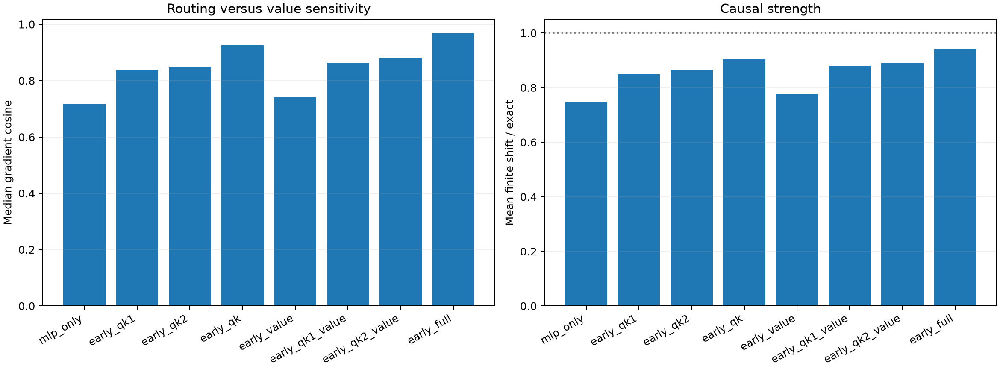

# Full replication of early QK/value suffix programs

All 96 frozen semantic sites are evaluated with exact local QK1, QK2, and value VJPs and finite top-64 Layer-1 channel patches.

Maximum local recomposition error: `9.21e-08`.

## Locked hypotheses

- **N0_factor_program_is_exact: supported.**
- **N1_qk_routing_replication: supported.**
- **N2_qk_routing_is_causally_useful: supported.**
- **N3_value_transport_is_insufficient: supported.**
- **N4_value_adds_limited_increment_beyond_qk: supported.**
- **N5_two_qk_factors_are_complementary: supported.**
- **N6_qk_routing_transfers_across_features: supported.**
- **N7_no_single_qk_factor_plus_value_is_sufficient: supported.**

| Enabled early derivative | Gradient cosine / Q10 | Contribution cosine | Finite direction | Shift / exact |
|---|---:|---:|---:|---:|
| mlp_only | 0.717/0.498 | 0.695 | 0.990 | 0.748 |
| early_qk1 | 0.836/0.696 | 0.842 | 0.990 | 0.850 |
| early_qk2 | 0.847/0.760 | 0.847 | 0.990 | 0.864 |
| early_qk | 0.926/0.858 | 0.930 | 0.990 | 0.905 |
| early_value | 0.740/0.546 | 0.731 | 0.990 | 0.778 |
| early_qk1_value | 0.864/0.769 | 0.870 | 0.990 | 0.879 |
| early_qk2_value | 0.881/0.797 | 0.877 | 0.990 | 0.890 |
| early_full | 0.969/0.909 | 0.971 | 0.979 | 0.942 |
| all_full | 1.000/1.000 | 1.000 | 0.990 | 1.000 |

## QK-only transfer by feature

| Feature | Median cosine | Finite direction |
|---|---:|---:|
| numeric | 0.913 | 1.000 |
| word_continuation | 0.939 | 1.000 |
| capitalized | 0.937 | 1.000 |
| newline | 0.893 | 1.000 |
| period | 0.908 | 1.000 |
| pronoun | 0.937 | 0.917 |
| code_operator | 0.921 | 1.000 |
| determiner | 0.930 | 1.000 |

## Guardrail

QK dominance here means local sensitivity routing explains the Layer-1 semantic gradient better than current-value sensitivity. The QK program still composes two routing factors across eight blocks and all heads and positions; it is not yet a sparse human-readable circuit.
