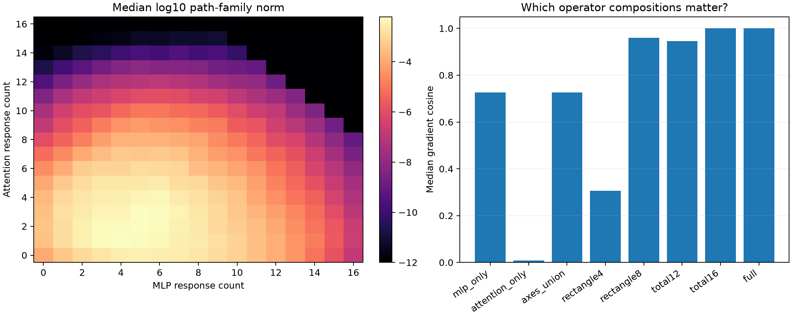

# MLP×attention bidegree pilot for semantic suffix gradients

Every exact backward path is indexed by how many MLP responses and attention responses it contains; the within-block attention-after-MLP term increments both counts. Sixteen frozen sites test pure-family axes, cross-family rectangles, and total-degree controls.

## Locked hypotheses

- **B0_bidegree_recomposition_is_exact: supported.**
- **B1_both_operator_families_are_material: supported.**
- **B2_cross_family_paths_are_necessary: supported.**
- **B3_eight_by_eight_rectangle_is_sufficient: supported.**
- **B4_four_by_four_rectangle_is_insufficient: supported.**
- **B5_eight_by_eight_preserves_sparse_leverage: supported.**

| Program | Gradient cosine | Relative error | Contribution cosine | Leverage ratio |
|---|---:|---:|---:|---:|
| full | 1.000 | 0.000 | 1.000 | 1.000 |
| mlp_only | 0.727 | 0.688 | 0.696 | 0.725 |
| attention_only | 0.008 | 1.000 | 0.010 | 0.094 |
| axes_union | 0.726 | 0.689 | 0.698 | 0.710 |
| rectangle4 | 0.305 | 1.371 | 0.345 | 0.392 |
| rectangle8 | 0.959 | 0.290 | 0.962 | 0.952 |
| rectangle12 | 1.000 | 0.009 | 1.000 | 1.000 |
| total12 | 0.945 | 0.367 | 0.934 | 0.958 |
| total16 | 1.000 | 0.012 | 1.000 | 1.000 |

## Guardrail

Bidegree is an invariant interaction-count description, not a localization to particular layers or heads. A rectangle can still contain many exact paths executed through the native state-conditioned operators.
