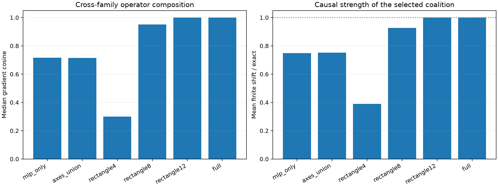

# Full finite replication of the MLP×attention bidegree program

All 96 frozen same-token semantic pairs are evaluated. Each bidegree truncation selects its own top-64 positive-contribution channels, which are patched through the complete nonlinear suffix.

## Locked hypotheses

- **J0_full_bidegree_recomposition_is_exact: supported.**
- **J1_rectangle8_replication: not supported.**
- **J2_rectangle8_finite_direction: supported.**
- **J3_rectangle8_causal_strength: supported.**
- **J4_cross_paths_beat_axes: supported.**
- **J5_rectangle8_transfers_across_features: supported.**
- **J6_rectangle4_is_insufficient_control: supported.**

| Program | Grad. cosine / Q10 | Contribution cosine | Leverage | Finite direction | Mean shift ratio |
|---|---:|---:|---:|---:|---:|
| mlp_only | 0.717/0.498 | 0.695 | 0.702 | 0.990 | 0.748 |
| axes_union | 0.715/0.500 | 0.694 | 0.706 | 0.990 | 0.753 |
| rectangle4 | 0.300/0.103 | 0.300 | 0.313 | 0.938 | 0.389 |
| rectangle8 | 0.952/0.743 | 0.951 | 0.956 | 0.979 | 0.926 |
| rectangle12 | 1.000/1.000 | 1.000 | 1.000 | 0.990 | 1.000 |
| full | 1.000/1.000 | 1.000 | 1.000 | 0.990 | 1.000 |
| exact | 1.000/1.000 | 1.000 | 1.000 | 0.990 | 1.000 |

## Guardrail

The rectangle is an operator-interaction grammar. It is not a sparse edge list and does not imply that attention has an independent semantic direction; the axes-versus-cross-path comparison tests that distinction.
