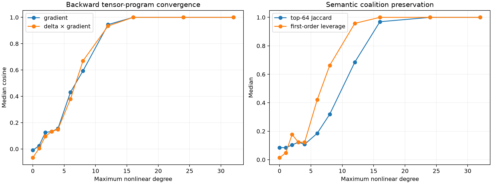

# Layer-1 semantic suffix backward-degree pilot

Each Layer-2–17 local backward operator is decomposed exactly into identity, MLP, attention, and attention-after-MLP terms. The exponentially many paths are grouped by total nonlinear interaction degree and accumulated without choosing layers or fitting evaluation effects.

## Locked hypotheses

- **E0_full_degree_recomposition_is_exact: supported.**
- **E1_degree4_is_useful: not supported.**
- **E2_degree8_is_high_fidelity: not supported.**
- **E3_degree8_preserves_contributions: not supported.**
- **E4_degree8_preserves_sparse_leverage: not supported.**
- **E5_degree8_transfers_across_features: not supported.**

| Degree ≤ | Gradient cosine | Relative error | Contribution cosine | Support Jaccard | Leverage ratio |
|---:|---:|---:|---:|---:|---:|
| 0 | -0.010 | 1.000 | -0.066 | 0.085 | 0.014 |
| 1 | 0.024 | 1.002 | 0.004 | 0.085 | 0.048 |
| 2 | 0.125 | 1.024 | 0.095 | 0.104 | 0.177 |
| 3 | 0.133 | 1.165 | 0.133 | 0.123 | 0.122 |
| 4 | 0.154 | 1.549 | 0.148 | 0.108 | 0.123 |
| 6 | 0.431 | 1.887 | 0.379 | 0.185 | 0.421 |
| 8 | 0.594 | 1.695 | 0.670 | 0.320 | 0.663 |
| 12 | 0.945 | 0.367 | 0.934 | 0.685 | 0.958 |
| 16 | 1.000 | 0.012 | 1.000 | 0.969 | 1.000 |
| 24 | 1.000 | 0.000 | 1.000 | 1.000 | 1.000 |
| 32 | 1.000 | 0.000 | 1.000 | 1.000 | 1.000 |

## Guardrail

This pilot uses sixteen sites, one extreme and one uniform pair per feature. Exact degree-32 recomposition is the implementation gate; lower-degree conclusions require a larger held-out replication and finite patching.
