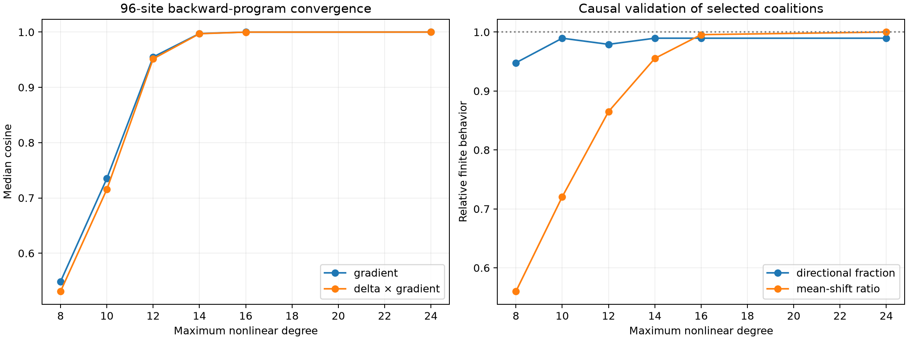

# Full replication of the Layer-1 suffix backward-degree program

The exact identity/MLP/attention/attention-after-MLP expansion is evaluated on all 96 frozen semantic donor–recipient pairs. For each degree cutoff, its predicted gradient selects 64 positive-contribution native channels, which are then patched finitely through the complete nonlinear suffix.

## Locked hypotheses

- **R0_degree24_recomposition_is_exact: supported.**
- **R1_degree12_gradient_replication: not supported.**
- **R2_degree12_finite_coalitions_are_directional: supported.**
- **R3_degree12_preserves_causal_strength: supported.**
- **R4_degree16_matches_exact_coalitions: supported.**
- **R5_degree12_transfers_across_features: supported.**
- **R6_degree8_remains_an_insufficient_control: supported.**

Exact-gradient top-64 finite direction: **0.990**; mean shift: **+0.3344**.

| Degree ≤ | Grad. cosine / Q10 | Contribution cosine | Leverage | Finite direction | Mean shift |
|---:|---:|---:|---:|---:|---:|
| 8 | 0.549/0.199 | 0.531 | 0.541 | 0.948 | +0.1873 |
| 10 | 0.735/0.340 | 0.716 | 0.755 | 0.990 | +0.2409 |
| 12 | 0.955/0.560 | 0.952 | 0.946 | 0.979 | +0.2893 |
| 14 | 0.997/0.907 | 0.997 | 0.998 | 0.990 | +0.3194 |
| 16 | 1.000/0.996 | 1.000 | 1.000 | 0.990 | +0.3329 |
| 24 | 1.000/1.000 | 1.000 | 1.000 | 0.990 | +0.3344 |

## Interpretation guardrail

Interaction degree is program complexity, not neuron count. A degree-12 cutoff still executes the native local tensor maps across sixteen blocks and sums many layer paths; its value is an invariant algebraic truncation, not a claim that twelve neurons or twelve literal circuits suffice.
