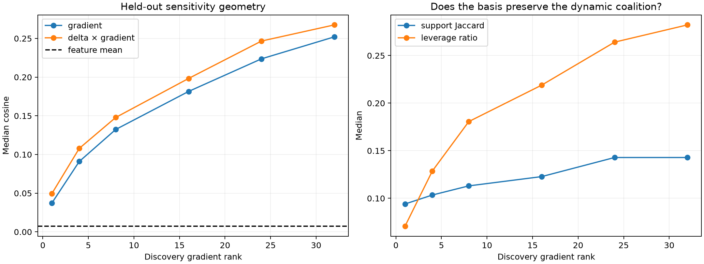

# Reusable subspace for Layer-1 semantic suffix gradients

Thirty-two exact gradients from disjoint discovery contexts (four per semantic feature) define an uncentered SVD basis. Held-out gradients, their elementwise products with held-out activation deltas, and the resulting top-64 positive supports are evaluated without refitting.

## Locked hypotheses

- **G0_rank16_gradient_transfer: not supported.**
- **G1_rank32_gradient_transfer: not supported.**
- **G2_rank32_contribution_transfer: not supported.**
- **G3_rank32_support_transfer: not supported.**
- **G4_rank32_preserves_first_order_leverage: not supported.**
- **G5_subspace_beats_feature_mean: supported.**

Feature-mean gradient cosine: **0.007**; random rank-32 projection: **0.084**.

| Rank | Gradient cosine | Q10 | Contribution cosine | Top-64 Jaccard | First-order leverage ratio |
|---:|---:|---:|---:|---:|---:|
| 1 | 0.037 | 0.007 | 0.050 | 0.094 | 0.071 |
| 4 | 0.091 | 0.054 | 0.108 | 0.103 | 0.129 |
| 8 | 0.132 | 0.088 | 0.148 | 0.113 | 0.181 |
| 16 | 0.182 | 0.138 | 0.198 | 0.123 | 0.219 |
| 24 | 0.224 | 0.179 | 0.247 | 0.143 | 0.264 |
| 32 | 0.252 | 0.214 | 0.268 | 0.143 | 0.282 |

## Guardrail

Projection coefficients are computed from the held-out exact gradient. This tests whether a reusable basis exists, not whether a cheap router can infer its coefficients from the forward state. Finite intervention must also be rerun before support transfer counts as causal compression.
