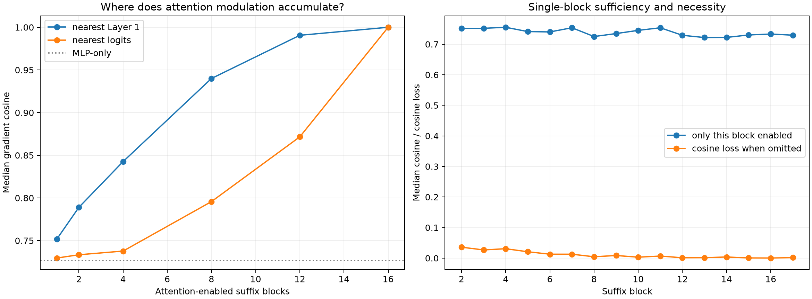

# Suffix attention-layer localization pilot

Exact local backward operators are retained, but the attention response is enabled only in specified suffix blocks. MLP and residual responses remain native in every block. Sixteen frozen sites are evaluated with exact finite top-64 channel patches.

## Locked hypotheses

- **L0_full_recurrence_is_exact: supported.**
- **L1_four_block_attention_window_is_sufficient: not supported.**
- **L2_eight_block_attention_window_is_sufficient: supported.**
- **L3_one_attention_block_is_sufficient: not supported.**
- **L4_one_attention_block_is_decisive: not supported.**
- **L5_both_ends_beat_either_four_block_end: not supported.**
- **L6_mlp_only_retains_causal_direction: supported.**

| Attention-enabled blocks | Gradient cosine | Q10 | Contribution cosine | Finite direction | Shift / exact |
|---|---:|---:|---:|---:|---:|
| mlp_only | 0.727 | 0.456 | 0.696 | 0.938 | 0.755 |
| source_1 | 0.752 | 0.503 | 0.708 | 1.000 | 0.787 |
| source_2 | 0.789 | 0.537 | 0.771 | 1.000 | 0.802 |
| source_4 | 0.843 | 0.680 | 0.846 | 1.000 | 0.904 |
| source_8 | 0.940 | 0.896 | 0.942 | 1.000 | 0.936 |
| source_12 | 0.991 | 0.955 | 0.990 | 1.000 | 0.982 |
| logit_1 | 0.730 | 0.455 | 0.691 | 0.938 | 0.757 |
| logit_2 | 0.733 | 0.473 | 0.693 | 0.938 | 0.765 |
| logit_4 | 0.738 | 0.579 | 0.724 | 0.938 | 0.783 |
| logit_8 | 0.796 | 0.648 | 0.784 | 1.000 | 0.757 |
| logit_12 | 0.872 | 0.750 | 0.871 | 1.000 | 0.865 |
| both_ends_4 | 0.892 | 0.754 | 0.892 | 1.000 | 0.932 |
| full | 1.000 | 1.000 | 1.000 | 1.000 | 1.000 |

## Guardrail

This is a local backward-mechanism intervention: disabling a block's attention response removes its Jacobian contribution while preserving the native forward state and all MLP responses. It localizes sensitivity routing, not a standalone forward circuit.
