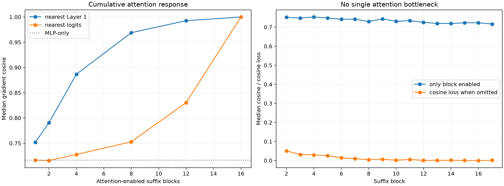

# Full replication of suffix attention-layer localization

All 96 frozen sites are evaluated. Attention Jacobian responses are enabled in specified blocks while every residual and MLP response remains native; each program selects and finitely patches its own top-64 Layer-1 channels.

## Locked hypotheses

- **K0_full_recurrence_is_exact: supported.**
- **K1_source_eight_replication: supported.**
- **K2_source_eight_causal_replication: supported.**
- **K3_early_attention_beats_late_attention: supported.**
- **K4_no_single_attention_block_is_sufficient: supported.**
- **K5_no_single_attention_block_is_decisive: supported.**
- **K6_source_eight_transfers_across_features: supported.**
- **K7_source_four_is_insufficient_control: supported.**

| Attention-enabled blocks | Gradient cosine / Q10 | Contribution cosine | Finite direction | Shift / exact |
|---|---:|---:|---:|---:|
| mlp_only | 0.717/0.498 | 0.695 | 0.990 | 0.748 |
| source_1 | 0.752/0.556 | 0.757 | 1.000 | 0.797 |
| source_2 | 0.791/0.632 | 0.808 | 1.000 | 0.832 |
| source_4 | 0.887/0.750 | 0.891 | 0.990 | 0.898 |
| source_8 | 0.969/0.909 | 0.971 | 0.979 | 0.942 |
| source_12 | 0.993/0.973 | 0.993 | 0.990 | 0.984 |
| logit_1 | 0.716/0.502 | 0.697 | 0.990 | 0.759 |
| logit_2 | 0.716/0.506 | 0.703 | 0.990 | 0.763 |
| logit_4 | 0.728/0.555 | 0.718 | 0.990 | 0.772 |
| logit_8 | 0.753/0.595 | 0.747 | 1.000 | 0.783 |
| logit_12 | 0.830/0.722 | 0.835 | 1.000 | 0.850 |
| both_ends_4 | 0.903/0.787 | 0.915 | 1.000 | 0.926 |
| full | 1.000/1.000 | 1.000 | 0.990 | 1.000 |

## Source-eight transfer by feature

| Feature | Median gradient cosine | Finite direction |
|---|---:|---:|
| numeric | 0.971 | 0.917 |
| word_continuation | 0.977 | 1.000 |
| capitalized | 0.968 | 1.000 |
| newline | 0.929 | 1.000 |
| period | 0.936 | 1.000 |
| pronoun | 0.979 | 0.917 |
| code_operator | 0.958 | 1.000 |
| determiner | 0.969 | 1.000 |

## Guardrail

The early-window advantage is an ordering result for local sensitivity transport. It does not by itself mean early blocks contain more semantic content: an early attention response also has more downstream MLP operators through which to be transformed.
