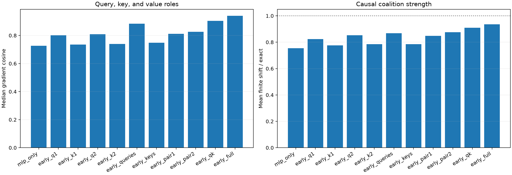

# Early suffix query/key-role pilot

The exact attention VJP is split into Q1, K1, Q2, K2, and current-value derivatives. Programs compose selected roles through Blocks 2–9 and the native MLP/residual suffix.

Maximum local role recomposition error: `8.36e-08`.

## Locked hypotheses

- **O0_role_vjps_recompose_native_attention: supported.**
- **O1_query_roles_are_sufficient: not supported.**
- **O2_key_roles_are_insufficient: supported.**
- **O3_queries_beat_keys: supported.**
- **O4_two_query_factors_are_complementary: supported.**
- **O5_two_qk_pairs_are_complementary: supported.**
- **O6_nonquery_increment_is_limited: supported.**

| Enabled role | Gradient cosine / Q10 | Contribution cosine | Finite direction | Shift / exact |
|---|---:|---:|---:|---:|
| mlp_only | 0.727/0.456 | 0.696 | 0.938 | 0.755 |
| early_q1 | 0.801/0.672 | 0.803 | 1.000 | 0.824 |
| early_k1 | 0.735/0.471 | 0.728 | 0.938 | 0.776 |
| early_q2 | 0.809/0.704 | 0.806 | 1.000 | 0.853 |
| early_k2 | 0.739/0.470 | 0.715 | 1.000 | 0.785 |
| early_queries | 0.883/0.757 | 0.878 | 1.000 | 0.868 |
| early_keys | 0.748/0.476 | 0.730 | 1.000 | 0.785 |
| early_pair1 | 0.812/0.666 | 0.826 | 1.000 | 0.848 |
| early_pair2 | 0.825/0.723 | 0.815 | 1.000 | 0.875 |
| early_qk | 0.904/0.845 | 0.902 | 1.000 | 0.909 |
| early_full | 0.940/0.896 | 0.942 | 1.000 | 0.936 |
| all_full | 1.000/1.000 | 1.000 | 1.000 | 1.000 |

## Structural red team

The current patch and output score use the same sequence position. Under causal attention, a backward key or value edge that moves to an earlier position cannot later return to the patched position. Query dominance may therefore be partly architectural. Cross-position interventions are required before interpreting it as learned semantic routing.
