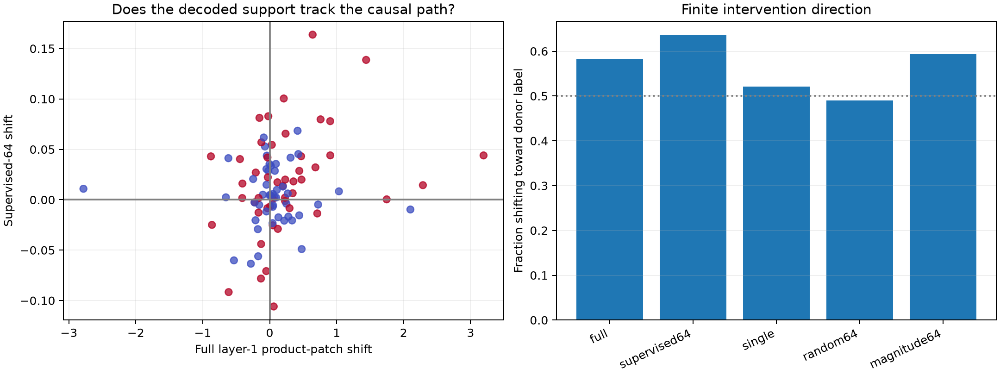

# Finite causal validation of supervised layer-1 coalitions

For each declared next-token feature, positive and negative held-out contexts are paired while holding the exact current token fixed. A donor's layer-1 product activations are patched into the negative recipient at the current position and propagated through all remaining layers. Supports are frozen from disjoint discovery examples. Half the pairs are strong held-out decoder examples; half are uniformly sampled token groups. No intervention outcome is used for pair or support selection.

## Locked hypotheses

- **P0_full_layer1_path_is_directional: not supported.**
- **P1_supervised_coalition_is_directional: supported.**
- **P2_coalition_tracks_full_path: not supported.**
- **P3_coalition_beats_single_neuron: not supported.**
- **P4_effect_is_not_only_extreme_selection: supported.**
- **P5_endpoint_magnitude_is_upper_control: supported.**

| Method | Directional all/extreme/uniform | Mean | Mean abs | Corr. with full |
|---|---:|---:|---:|---:|
| full | 0.583/0.604/0.562 | +0.1467 | 0.3889 | 1.000 |
| supervised64 | 0.635/0.688/0.583 | +0.0114 | 0.0315 | 0.218 |
| single | 0.521/0.458/0.583 | -0.0000 | 0.0222 | 0.199 |
| random64 | 0.490/0.479/0.500 | -0.0001 | 0.0187 | 0.195 |
| magnitude64 | 0.594/0.646/0.542 | +0.0250 | 0.1002 | 0.504 |

## Example interventions

| Feature | Selection | Current | Donor context → next | Recipient context → next | Full / supervised / random shift |
|---|---|---|---|---|---:|
| numeric | extreme | `,` | ` lien was worth less than $1,000` → `000` | ` babysitter! Who, I'm sure, doubts` → ` doubts` | +0.343/+0.006/-0.003 |
| numeric | extreme | `:` | ` 2012Sun 03-Mar-13 05:55` → `55` | ` BREAK)\nMATTHEWS: We` → ` We` | +0.442/+0.029/-0.003 |
| numeric | extreme | `.` | `\n|Permitted Values (>= 4.1` → `1` | `S: It‘s so smart. It` → ` It` | +0.196/+0.014/-0.001 |
| numeric | extreme | ` to` | `ERP,which lasted from 1948 to 1952` → ` 1952` | ` a multiprocessor, as opposed to a` → ` a` | +0.115/+0.017/-0.004 |
| numeric | extreme | `-` | ` Eredivisie with a 4-0` → `0` | `s love for non-French music\n- Hollande` → ` Hollande` | +0.230/-0.001/+0.006 |
| numeric | extreme | ` and` | ` With the having the same record of 32 and 35` → ` 35` | ` the elliptical machine over the treadmill, and why` → ` why` | -0.208/+0.027/+0.012 |
| numeric | uniform | ` The` | ` about all forms of violence against women. The 16` → ` 16` | ` by a renter's insurance policy. The Maryland` → ` Maryland` | +0.015/+0.004/+0.007 |
| numeric | uniform | `||` | `crystal-rose||1||523||18` → `18` | `, 2007||Hoover Russell D||S` → `S` | +0.106/+0.010/-0.008 |
| numeric | uniform | ` November` | `�<|endoftext|>Starting Phase II\nThursday, November 01` → ` 01` | `otti Park in November when` → ` when` | +0.249/-0.004/+0.024 |
| numeric | uniform | ` Francisco` | `.\nWhen the Baltimore Ravens and San Francisco 49` → ` 49` | ` This Job\nFull-Time ? San Francisco The` → ` The` | -0.102/+0.005/+0.014 |
| numeric | uniform | ` Tuesday` | ` better at it.\nDay three, Tuesday 18` → ` 18` | ` here.<|endoftext|>The National Rifle Association on Tuesday issued` → ` issued` | +0.279/-0.017/+0.031 |
| numeric | uniform | ` 1` | ` Walt Woodard Better Heading Vol. 1 2000` → ` 2000` | `igma) Binary options no deposit bonus blog 1,` → `,` | -0.043/+0.044/-0.021 |
| word_continuation | extreme | `�` | ` suggestion very seriously, as I hadn’t` → `t` | ` or the newer ‘fracking’ method` → ` method` | +0.296/-0.008/-0.012 |
| word_continuation | extreme | `C` | `-0261, Ext. 269<|endoftext|>Cancer` → `ancer` | ` logically inconsistent. Any bar in B.C.` → `.` | +1.440/+0.139/+0.050 |
| word_continuation | extreme | `P` | `, 2006||International Business Machines Corporation||Pip` → `ip` | `Addressing in Cray Research's MPP Fort` → ` Fort` | +3.194/+0.044/-0.032 |
| word_continuation | extreme | `in` | ` keys tiredemma\nHi, Cinam` → `am` | ` mentions "Plasma adiponectin,` → `,` | +1.747/+0.000/-0.007 |

## Guardrails

- The intervention changes one MLP product vector only; a null does not imply the feature is absent from attention or the residual stream.
- The output score is the declared class's mean clipped logit minus its complement, not the probability of the observed next token.
- Endpoint-magnitude support reads the donor-recipient activation difference and is therefore an upper control, not a prospective interpretation method.
