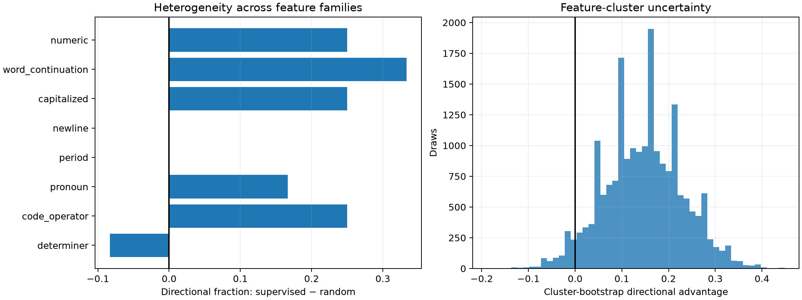

# Cluster-aware uncertainty red team

The intervention preregistration treats the 96 held-out pairs descriptively. This post-hoc red team resamples the eight semantic features first and the twelve pairs within each sampled feature second, so repeated text pairs do not masquerade as 96 independent conceptual replications.

The supervised-minus-random directional advantage is **+0.146**, with a feature-cluster bootstrap 95% interval of **[-0.021, +0.312]**. The mean class-score shift advantage is **+0.0116**, interval **[+0.0011, +0.0233]**.

Features with positive / zero / negative directional advantage: **5 / 2 / 1**.

Therefore the aggregate finite intervention is promising but **not yet a feature-level replication**: the directional interval crosses zero. The locked site-level threshold remains reported as passed; the stronger claim that the effect generalizes across feature families is not validated.

| Feature | Supervised | Random | Advantage | Mean supervised shift | Mean full shift |
|---|---:|---:|---:|---:|---:|
| numeric | 0.750 | 0.500 | +0.250 | +0.0112 | +0.1351 |
| word_continuation | 0.583 | 0.250 | +0.333 | +0.0123 | +0.9176 |
| capitalized | 0.667 | 0.417 | +0.250 | +0.0009 | +0.0121 |
| newline | 0.583 | 0.583 | +0.000 | +0.0140 | -0.1318 |
| period | 0.500 | 0.500 | +0.000 | +0.0085 | -0.0643 |
| pronoun | 0.667 | 0.500 | +0.167 | +0.0050 | +0.0132 |
| code_operator | 0.750 | 0.500 | +0.250 | +0.0221 | +0.0134 |
| determiner | 0.583 | 0.667 | -0.083 | +0.0173 | +0.2785 |
