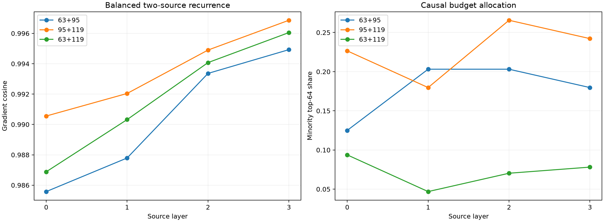

# Strength-balanced two-source selector

For each FineWeb example and source-position pair, two single-token replacements are selected from a fixed, preregistered vocabulary using only their individual output-effect norms. The selection objective favors both materiality and equal strength. The joint edit, tensor selector, and finite intervention are then evaluated separately.

Median smaller/larger single-edit norm ratio: **0.895**.
Median output interaction/joint-change norm: **0.159**.
Median minority-position top-64 share: **0.172**, versus **0.055** in the fixed-newline assay.
Maximum exact-recurrence error: `1.32e-06`.

## Locked hypotheses

- **B0_single_edit_effects_are_balanced: supported.**
- **B1_balancing_increases_two_source_support: supported.**
- **B2_both_sources_are_material: supported.**
- **B3_near12_gradient_fidelity: supported.**
- **B4_near12_finite_direction: supported.**
- **B5_near12_retains_exact_effect: supported.**
- **B6_output_interaction_is_material: supported.**

| Layer | Positions | Near 8 cosine | Near 12 cosine/Q10 | Near 12 support | Finite direction | Effect/exact |
|---:|---|---:|---:|---:|---:|---:|
| 0 | 63+95 | 0.822 | 0.986/0.927 | 0.816 | 1.000 | 0.965 |
| 0 | 95+119 | 0.883 | 0.991/0.967 | 0.829 | 1.000 | 0.979 |
| 0 | 63+119 | 0.894 | 0.987/0.958 | 0.803 | 1.000 | 0.962 |
| 1 | 63+95 | 0.910 | 0.988/0.951 | 0.816 | 1.000 | 0.968 |
| 1 | 95+119 | 0.931 | 0.992/0.978 | 0.829 | 1.000 | 0.988 |
| 1 | 63+119 | 0.950 | 0.990/0.968 | 0.803 | 1.000 | 0.939 |
| 2 | 63+95 | 0.943 | 0.993/0.966 | 0.855 | 1.000 | 0.997 |
| 2 | 95+119 | 0.952 | 0.995/0.990 | 0.869 | 1.000 | 0.987 |
| 2 | 63+119 | 0.960 | 0.994/0.987 | 0.829 | 1.000 | 0.995 |
| 3 | 63+95 | 0.975 | 0.995/0.969 | 0.869 | 1.000 | 1.003 |
| 3 | 95+119 | 0.981 | 0.997/0.995 | 0.910 | 1.000 | 1.000 |
| 3 | 63+119 | 0.978 | 0.996/0.990 | 0.869 | 1.000 | 0.991 |

## Guardrails

The replacement search deliberately conditions on individual output-effect magnitude, so it is an adversarial balance control—not a natural estimate of how often two equally important sources occur. It does not use gradients, channel identities, joint effects, or semantic labels. A positive result would establish that the tensor recurrence can allocate one sparse causal budget across multiple material sources; it would not establish a persistent multi-token concept neuron.
