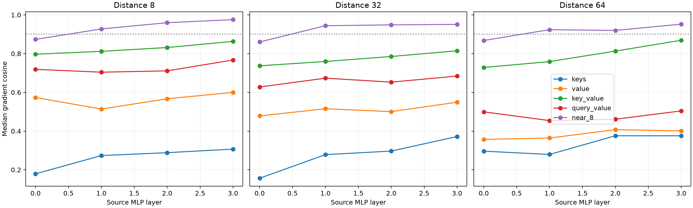

# Layers 0–3 cross-position transport red team

A natural FineWeb token is replaced by newline at distances 8, 32, and 64 from the output position. The full model's probability-change direction defines the behavior. Source-layer MLP-product sensitivity must travel across positions through key or value roles; query-only and MLP-only paths are structurally unable to do so.

Maximum local role recomposition error: `8.32e-08`.

## Locked hypotheses

- **T0_exact_role_composition: supported.**
- **T1_nontransport_roles_are_zero: supported.**
- **T2_key_value_is_material: supported.**
- **T3_no_transport_role_is_sufficient: supported.**
- **T4_near_eight_blocks_are_sufficient: not supported.**
- **T5_top64_finite_direction: supported.**

| Layer | Distance | Keys | Value | Key+value | Query+value | Near 8 | Exact top-64 direction |
|---:|---:|---:|---:|---:|---:|---:|---:|
| 0 | 8 | 0.179 | 0.573 | 0.797 | 0.719 | 0.873 | 1.000 |
| 0 | 32 | 0.157 | 0.478 | 0.737 | 0.628 | 0.860 | 1.000 |
| 0 | 64 | 0.296 | 0.357 | 0.728 | 0.499 | 0.868 | 1.000 |
| 1 | 8 | 0.274 | 0.514 | 0.812 | 0.704 | 0.927 | 1.000 |
| 1 | 32 | 0.279 | 0.515 | 0.760 | 0.673 | 0.944 | 1.000 |
| 1 | 64 | 0.279 | 0.364 | 0.759 | 0.454 | 0.924 | 1.000 |
| 2 | 8 | 0.289 | 0.567 | 0.831 | 0.711 | 0.960 | 1.000 |
| 2 | 32 | 0.297 | 0.500 | 0.785 | 0.653 | 0.949 | 1.000 |
| 2 | 64 | 0.376 | 0.407 | 0.813 | 0.461 | 0.920 | 1.000 |
| 3 | 8 | 0.307 | 0.600 | 0.863 | 0.767 | 0.976 | 1.000 |
| 3 | 32 | 0.372 | 0.549 | 0.815 | 0.684 | 0.951 | 1.000 |
| 3 | 64 | 0.376 | 0.401 | 0.869 | 0.504 | 0.952 | 1.000 |

## Guardrail

This assay explains an already identified behavioral change and does not discover a semantic feature prospectively. Its value is architectural: it prevents same-position query dominance from being mistaken for a universal learned ontology.
