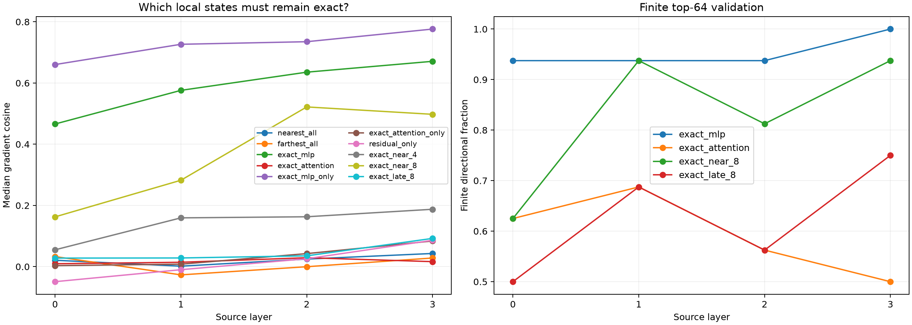

# Local-operator state-swap pilot across Layers 0–3

The output objective and final RMS/unembedding adjoint remain fixed to the target example. Each suffix block's exact MLP and attention VJP is then evaluated either at the target state or at a same-position reference context. References are selected as the nearest or farthest atlas state under the complete current-position forward trajectory.

## Locked hypotheses

- **S0_exact_state_program_reconstructs_gradient: supported.**
- **S1_nearest_reference_operator_is_reusable: not supported.**
- **S2_one_operator_family_is_mostly_reusable: not supported.**
- **S3_exact_near_eight_states_are_sufficient: not supported.**
- **S4_near_states_matter_more_than_late_states: supported.**
- **S5_forward_similarity_selects_better_operator_state: not supported.**
- **S6_best_single_family_hybrid_is_finitely_directional: supported.**

| Layer | Nearest all | Farthest all | Exact MLP + wrong attn. | Exact attn. + wrong MLP | Exact MLP only | Exact attn. only | Residual only | Exact near 4 | Exact near 8 | Exact late 8 | Exact |
|---:|---:|---:|---:|---:|---:|---:|---:|---:|---:|---:|---:|
| 0 | 0.021 | 0.033 | 0.466 | 0.009 | 0.660 | 0.003 | -0.049 | 0.055 | 0.163 | 0.028 | 1.000 |
| 1 | 0.002 | -0.027 | 0.576 | 0.014 | 0.727 | 0.008 | -0.010 | 0.159 | 0.282 | 0.028 | 1.000 |
| 2 | 0.025 | -0.000 | 0.635 | 0.029 | 0.735 | 0.043 | 0.026 | 0.163 | 0.522 | 0.035 | 1.000 |
| 3 | 0.043 | 0.028 | 0.671 | 0.016 | 0.776 | 0.084 | 0.086 | 0.188 | 0.498 | 0.092 | 1.000 |

## Post-hoc poisoning controls

The MLP-only, attention-only, and residual-only rows were added after inspecting the first swap result. They distinguish omission of an operator family from insertion of a wrong-context Jacobian and are exploratory, not locked hypotheses.

## Guardrails

This is a local-Jacobian swap, not a valid forward counterfactual trajectory: MLP and attention Jacobians from different contexts can be composed even though no natural input would realize the hybrid. That is intentional for necessity localization. Keeping the target final adjoint makes reuse easier, so failure of a swapped program is strong evidence that intermediate local states matter; success would not by itself provide a generative interpreter.
