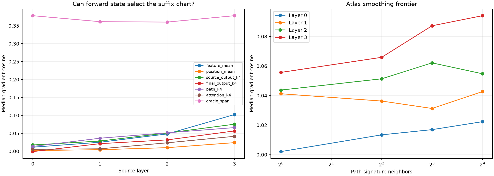

# Prospective Layers 0–3 chart retrieval

A bank of 512 disjoint FineWeb charts contains two examples for each of eight semantic objectives at each of 32 positions. Held-out gradients are never used for chart selection. Retrieval uses only forward-pass signatures; the oracle span sees the held-out gradient only as an expressivity upper bound.

## Locked hypotheses

- **R0_feature_chart_span_is_expressive: not supported.**
- **R1_path_retrieval_beats_feature_mean: not supported.**
- **R2_path_retrieval_beats_position_lookup: not supported.**
- **R3_weight_attention_signature_beats_source_state: not supported.**
- **R4_path_retrieval_is_not_only_position: supported.**
- **R5_path_retrieval_beats_shuffled_chart_map: not supported.**
- **R6_path_retrieval_preserves_leverage: not supported.**
- **R7_path_retrieval_is_finitely_directional: not supported.**

| Layer | Mean | Position | Token K4 | Source K4 | Final K4 | Path K4 | Path excluding position | Attention K4 | Shuffled path | Oracle span | Exact |
|---:|---:|---:|---:|---:|---:|---:|---:|---:|---:|---:|---:|
| 0 | 0.011 | 0.002 | 0.009 | 0.017 | -0.001 | 0.013 | 0.008 | 0.005 | 0.010 | 0.378 | 1.000 |
| 1 | 0.025 | 0.004 | 0.021 | 0.028 | 0.021 | 0.036 | 0.034 | 0.007 | 0.009 | 0.361 | 1.000 |
| 2 | 0.048 | 0.010 | 0.021 | 0.051 | 0.032 | 0.051 | 0.048 | 0.023 | 0.014 | 0.360 | 1.000 |
| 3 | 0.102 | 0.024 | 0.059 | 0.075 | 0.057 | 0.066 | 0.067 | 0.042 | 0.044 | 0.378 | 1.000 |

| Layer | Path contribution cosine | Path leverage | Path finite direction | Oracle-span cosine |
|---:|---:|---:|---:|---:|
| 0 | 0.024 | 0.064 | 0.656 | 0.378 |
| 1 | 0.041 | 0.026 | 0.646 | 0.361 |
| 2 | 0.065 | 0.091 | 0.760 | 0.360 |
| 3 | 0.074 | 0.088 | 0.760 | 0.378 |

## Guardrails

This is an atlas-retrieval test, not yet a parametric interpreter. The full-path signature requires a complete forward pass and may encode nearly the same state distinctions that determine the output. The attention signature is more architecture-specific but still uses native attention patterns from eight blocks. The oracle-span row establishes what the finite chart bank could represent if its coefficients were known; it is not a prospective result.
