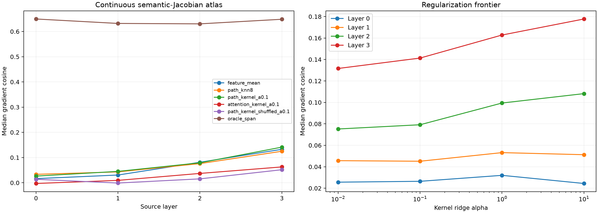

# Full semantic-Jacobian atlas for Layers 0–3

At each of 256 disjoint FineWeb states, the atlas stores gradients for all eight semantic output objectives. This removes the sparse atlas's confound between state sampling and output objective. Prospective routers use only forward-pass signatures; oracle projection remains an expressivity ceiling.

## Locked hypotheses

- **J0_full_semantic_chart_span_is_expressive: not supported.**
- **J1_path_knn_is_useful: not supported.**
- **J2_path_kernel_router_is_useful: not supported.**
- **J3_path_kernel_beats_feature_mean: not supported.**
- **J4_path_kernel_beats_knn: not supported.**
- **J5_path_kernel_is_not_only_position: supported.**
- **J6_path_kernel_is_finitely_directional: not supported.**
- **J7_path_kernel_preserves_leverage: not supported.**
- **J8_weight_signature_is_competitive: supported.**
- **J9_complete_jacobians_improve_sparse_atlas: not supported.**

| Layer | Mean | Position | Path K8 | Path kernel | Exclude position | Attention kernel | Shuffled | Oracle span | Exact |
|---:|---:|---:|---:|---:|---:|---:|---:|---:|---:|
| 0 | 0.016 | -0.003 | 0.034 | 0.026 | 0.024 | -0.003 | 0.014 | 0.650 | 1.000 |
| 1 | 0.031 | 0.006 | 0.043 | 0.045 | 0.046 | 0.010 | -0.001 | 0.632 | 1.000 |
| 2 | 0.081 | 0.022 | 0.076 | 0.079 | 0.083 | 0.037 | 0.016 | 0.630 | 1.000 |
| 3 | 0.133 | 0.054 | 0.125 | 0.141 | 0.140 | 0.063 | 0.052 | 0.649 | 1.000 |

| Layer | Path contribution cosine | Path leverage | Path finite direction | Sparse/full K8 |
|---:|---:|---:|---:|---:|
| 0 | 0.029 | 0.047 | 0.677 | 0.017/0.034 |
| 1 | 0.055 | 0.103 | 0.729 | 0.031/0.043 |
| 2 | 0.083 | 0.108 | 0.792 | 0.062/0.076 |
| 3 | 0.147 | 0.145 | 0.812 | 0.087/0.125 |

## Guardrails

The kernel router is a continuous atlas interpolator, not yet a short tensor program. It requires a full forward trajectory and 256 stored states. The attention signature uses native weight-derived patterns from eight blocks but omits value contents and later blocks. A broad oracle span with a weak router means the operator family is representable but its chart coordinates are not captured by these forward similarities; a weak oracle span means the bank itself is still too small or the field is not globally low rank.
