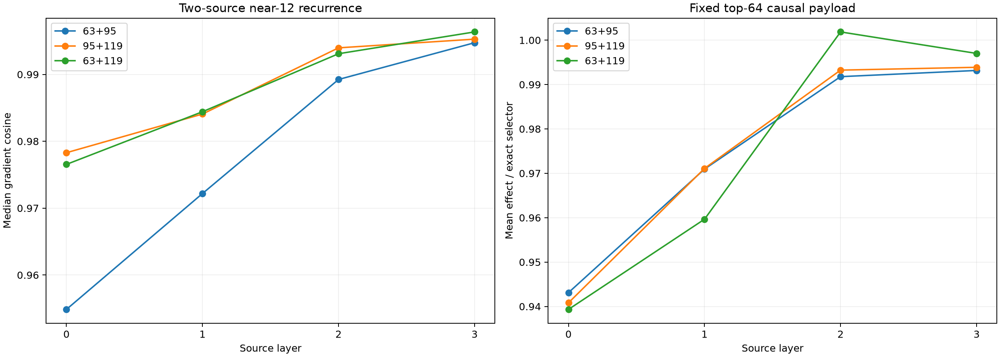

# Layers 0–3 two-source compositional selector

Two natural FineWeb tokens are replaced by newline together. One fixed top-64 product-channel budget is allocated across both earlier positions, while the behavioral direction is the full model's own joint probability change at Position 127. This tests whether the local tensor recurrence composes across source positions; it does not assume a human semantic label.

Maximum all-attention recurrence error against independent two-position autograd: `1.22e-06`.
Median output interaction norm / joint-change norm: `0.271`.
Median minority-position share of the exact top-64 support: `0.055`.

## Locked hypotheses

- **M0_exact_composition: supported.**
- **M1_near12_gradient_fidelity: supported.**
- **M2_near8_not_universal: supported.**
- **M3_fixed_budget_finite_direction: supported.**
- **M4_both_sources_are_used: not supported.**
- **M5_output_interaction_is_material: supported.**
- **M6_near12_retains_exact_effect: supported.**

| Layer | Positions | Near 8 cosine/Q10 | Near 12 cosine/Q10 | Near 12 support | Near 12 finite direction | Near 12/exact effect |
|---:|---|---:|---:|---:|---:|---:|
| 0 | 63+95 | 0.773/0.545 | 0.955/0.895 | 0.684 | 1.000 | 0.943 |
| 0 | 95+119 | 0.785/0.619 | 0.978/0.832 | 0.803 | 1.000 | 0.941 |
| 0 | 63+119 | 0.789/0.608 | 0.977/0.849 | 0.718 | 1.000 | 0.939 |
| 1 | 63+95 | 0.884/0.667 | 0.972/0.915 | 0.753 | 1.000 | 0.971 |
| 1 | 95+119 | 0.879/0.638 | 0.984/0.922 | 0.803 | 1.000 | 0.971 |
| 1 | 63+119 | 0.876/0.706 | 0.984/0.947 | 0.803 | 1.000 | 0.960 |
| 2 | 63+95 | 0.924/0.815 | 0.989/0.979 | 0.829 | 1.000 | 0.992 |
| 2 | 95+119 | 0.915/0.701 | 0.994/0.978 | 0.829 | 1.000 | 0.993 |
| 2 | 63+119 | 0.917/0.793 | 0.993/0.985 | 0.855 | 1.000 | 1.002 |
| 3 | 63+95 | 0.948/0.863 | 0.995/0.986 | 0.855 | 1.000 | 0.993 |
| 3 | 95+119 | 0.956/0.812 | 0.995/0.985 | 0.882 | 1.000 | 0.994 |
| 3 | 63+119 | 0.959/0.836 | 0.996/0.989 | 0.882 | 1.000 | 0.997 |

## Guardrails

The behavioral objective is automatically induced by the chosen two-token edit, but the edit itself is analyst supplied. The assay therefore tests multi-source compositional execution, not autonomous concept discovery. The interaction ratio distinguishes a genuinely nonlinear two-edit output from a purely additive pair, but the top-64 intervention targets the complete joint change rather than isolating only its Möbius interaction term.
