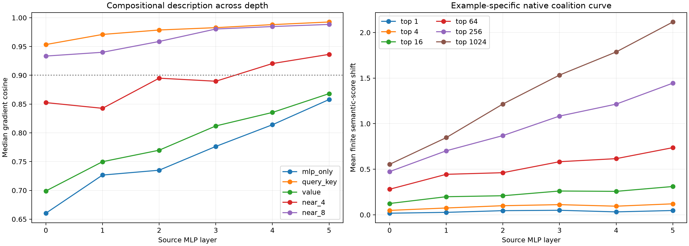

# Layers 0–5 compositional ontology

The same 16 held-out semantic donor–recipient pairs are inspected at each of 6 bilinear MLP product boundaries. Exact downstream gradients are composed block by block. This avoids explicitly expanding the network into a high-order polynomial: complexity is represented as a sequence of local, state-conditioned operators.

Maximum local Q/K/value recomposition error: `8.34e-08`.

## Locked hypotheses

- **D0_exact_composition_reconstructs_each_layer: supported.**
- **D1_local_role_factorization_is_exact: supported.**
- **D2_eight_nearby_attention_blocks_are_sufficient: supported.**
- **D3_qk_is_a_stable_same_position_grammar: supported.**
- **D4_qk_beats_value: supported.**
- **D5_rank64_is_directionally_sufficient: supported.**
- **D6_rank64_recovers_most_rank1024_effect: not supported.**
- **D7_single_neurons_are_not_sufficient: supported.**
- **D8_depth_does_not_make_native_coalitions_less_compact: supported.**

## Compositional programs

| Source layer | MLP only | Queries | Keys | QK | Value | Near 4 | Near 8 | Exact |
|---:|---:|---:|---:|---:|---:|---:|---:|---:|
| 0 | 0.660 | 0.924 | 0.688 | 0.953 | 0.699 | 0.853 | 0.933 | 1.000 |
| 1 | 0.727 | 0.949 | 0.746 | 0.971 | 0.750 | 0.843 | 0.940 | 1.000 |
| 2 | 0.735 | 0.964 | 0.768 | 0.979 | 0.770 | 0.895 | 0.959 | 1.000 |
| 3 | 0.776 | 0.971 | 0.798 | 0.983 | 0.812 | 0.890 | 0.980 | 1.000 |
| 4 | 0.814 | 0.979 | 0.829 | 0.988 | 0.835 | 0.920 | 0.985 | 1.000 |
| 5 | 0.858 | 0.987 | 0.875 | 0.993 | 0.868 | 0.936 | 0.988 | 1.000 |

## Native-neuron finite interventions

| Source layer | Top 1 | Top 4 | Top 16 | Top 64 | Top 256 | Top 1024 | Positive-mass K90 median (Q10–Q90) |
|---:|---:|---:|---:|---:|---:|---:|---:|
| 0 | +0.0174 | +0.0484 | +0.1239 | +0.2803 | +0.4738 | +0.5535 | 1038 (990–1070) |
| 1 | +0.0267 | +0.0746 | +0.1984 | +0.4442 | +0.7023 | +0.8468 | 1034 (987–1064) |
| 2 | +0.0453 | +0.0998 | +0.2090 | +0.4619 | +0.8690 | +1.2154 | 1052 (1019–1089) |
| 3 | +0.0495 | +0.1114 | +0.2610 | +0.5826 | +1.0833 | +1.5333 | 1050 (1012–1071) |
| 4 | +0.0320 | +0.0944 | +0.2572 | +0.6160 | +1.2143 | +1.7869 | 1053 (1037–1088) |
| 5 | +0.0470 | +0.1203 | +0.3104 | +0.7368 | +1.4444 | +2.1156 | 1040 (1007–1084) |

## Interpretation guardrail

The native-channel curves use an example-specific activation-times-exact-gradient oracle. They measure how many native channels are sufficient for a known edit at that state; they are not a prospective monosemanticity score. The role programs are likewise local linear explanations of downstream sensitivity, then checked with finite channel interventions.
