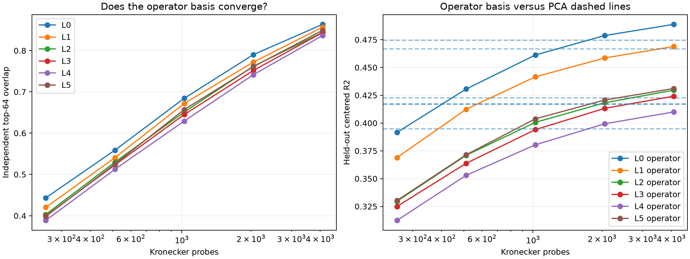

# Operator-tensor probe convergence red team

The early operator vocabulary is refit with 256--4096 independent Kronecker measurements per layer. Every basis is evaluated against a third, 4096-probe sketch on disjoint FineWeb states. At the maximum budget, semantic-axis scores must replicate in two independently fitted bases and matched axes must retain their semantic profiles.

## Locked hypotheses

- **C0_probe_overlap_converges: supported.**
- **C1_operator_reconstruction_beats_pca_after_convergence: supported.**
- **C2_semantic_axis_advantage_replicates: not supported.**
- **C3_semantic_axis_identity_replicates: not supported.**

| Layer | Overlap 256/512/1024/2048/4096 | Heldout R2 256/512/1024/2048/4096 | PCA64 | Semantic one A/B vs rotations | Matched cosine / semantic profile r |
|---:|---:|---:|---:|---:|---:|
| 0 | 0.443/0.559/0.684/0.790/0.864 | 0.392/0.431/0.461/0.479/0.489 | 0.474 | 0.663/0.670 vs 0.627/0.618 | 0.476/0.562 |
| 1 | 0.420/0.541/0.672/0.772/0.857 | 0.369/0.412/0.442/0.459/0.469 | 0.467 | 0.680/0.660 vs 0.634/0.629 | 0.551/0.523 |
| 2 | 0.403/0.530/0.651/0.762/0.844 | 0.330/0.371/0.401/0.418/0.430 | 0.423 | 0.669/0.662 vs 0.630/0.628 | 0.518/0.561 |
| 3 | 0.399/0.523/0.645/0.752/0.844 | 0.325/0.364/0.394/0.413/0.424 | 0.417 | 0.647/0.671 vs 0.632/0.636 | 0.494/0.572 |
| 4 | 0.389/0.512/0.629/0.742/0.836 | 0.312/0.353/0.380/0.399/0.410 | 0.395 | 0.659/0.670 vs 0.629/0.626 | 0.476/0.546 |
| 5 | 0.398/0.525/0.657/0.761/0.849 | 0.330/0.371/0.404/0.421/0.431 | 0.417 | 0.660/0.678 vs 0.635/0.631 | 0.472/0.569 |

## Guardrail

A converged Frobenius operator basis would be canonical only for the local MLP Jacobian under FineWeb covariance. Semantic-profile replication is stronger than a one-run axis AUROC, but it remains supervised evidence about a predeclared ontology. Failure to beat state PCA means tensor weighting did not provide a shorter predictive code, even if individual axes are reproducible.
