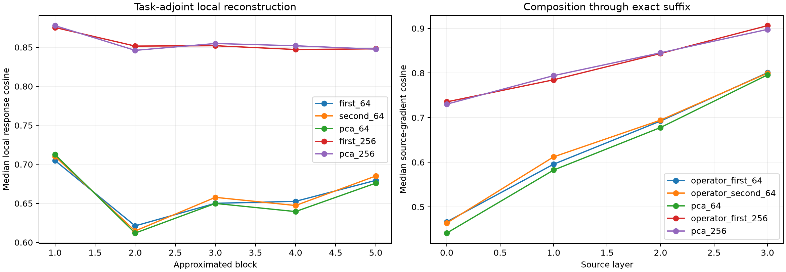

# Causal composition of the early operator vocabulary

The converged, label-free operator-state bases are frozen. At Blocks 1--5, the native state conditioning each bilinear MLP Jacobian is replaced by its operator-basis or state-PCA reconstruction; the actual RMSNorm pullback, all other positions, every attention derivative, and the remaining suffix stay exact. The resulting source-product gradients select top-64 native channels prospectively and are validated by finite suffix recomputation.

Maximum explicit weight-formula versus native VJP error: `1.55e-06`.

## Locked hypotheses

- **J0_weight_formula_matches_native_vjp: supported.**
- **J1_rank256_reconstructs_task_local_responses: not supported.**
- **J2_rank256_composes_through_suffix: not supported.**
- **J3_operator_rank64_beats_pca_causally: not supported.**
- **J4_operator_rank64_is_finitely_directional: supported.**
- **J5_independent_operator_bases_agree_causally: not supported.**
- **J6_operator_modes_beat_pca_on_task_responses: supported.**

| Block | Op64 A/B | PCA64 | Op256 | PCA256 |
|---:|---:|---:|---:|---:|
| 1 | 0.705/0.710 | 0.713 | 0.875 | 0.878 |
| 2 | 0.621/0.615 | 0.612 | 0.852 | 0.846 |
| 3 | 0.650/0.658 | 0.650 | 0.852 | 0.855 |
| 4 | 0.653/0.647 | 0.639 | 0.847 | 0.852 |
| 5 | 0.679/0.685 | 0.676 | 0.848 | 0.848 |

| Source layer | Op64 A/B gradient cosine | A↔B cosine | PCA64 | Op256 | PCA256 | Op64 finite direction |
|---:|---:|---:|---:|---:|---:|---:|
| 0 | 0.467/0.464 | 0.909 | 0.441 | 0.735 | 0.730 | 0.938 |
| 1 | 0.596/0.612 | 0.927 | 0.583 | 0.785 | 0.794 | 1.000 |
| 2 | 0.692/0.694 | 0.952 | 0.678 | 0.844 | 0.845 | 1.000 |
| 3 | 0.801/0.800 | 0.976 | 0.796 | 0.906 | 0.898 | 1.000 |

## Guardrails

Only Blocks 1--5 are compressed, so high composed fidelity does not claim that the entire suffix is rank 64 or 256. Conversely, a local Frobenius reconstruction can fail on a particular semantic adjoint even when its average operator R2 is good. Finite validation tests the selected source-channel intervention, not replacement of the model's forward MLP computation.
