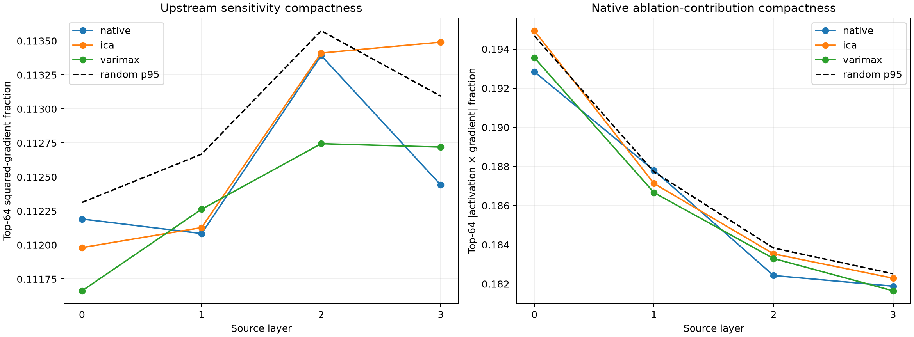

# Does the sparse output basis simplify upstream computation?

Native HOSVD, label-free ICA/varimax, and 32 matched rotations span exactly the same rank-16 late output space. Exact batched tensor VJPs transport all sixteen output objectives to MLP product channels in source Layers 0--3. Gradient energy and native zero-ablation contribution mass measure coordinate compactness; scale-0.1 finite interventions validate the local metric.

Maximum batched recurrence error against independent autograd: `2.27e-06`.

## Locked hypotheses

- **C0_exact_batched_recurrence: supported.**
- **C1_varimax_sparsifies_upstream_gradients: not supported.**
- **C2_varimax_sparsifies_native_contributions: not supported.**
- **C3_varimax_beats_native_upstream: not supported.**
- **C4_sparse_basis_is_depth_consistent: not supported.**
- **C5_local_compactness_survives_finite_edits: supported.**

| Layer | Basis | Gradient top-64 energy | Gradient support | Contribution top-64 mass | Contribution support |
|---:|---|---:|---:|---:|---:|
| 0 | native | 0.112 | 2920.2 | 0.193 | 810.9 |
| 0 | ica | 0.112 | 2920.4 | 0.195 | 803.1 |
| 0 | varimax | 0.112 | 2918.7 | 0.194 | 796.8 |
| 0 | random p95 | 0.112 | — | 0.195 | — |
| 1 | native | 0.112 | 2919.1 | 0.188 | 845.3 |
| 1 | ica | 0.112 | 2915.0 | 0.187 | 836.7 |
| 1 | varimax | 0.112 | 2918.4 | 0.187 | 850.8 |
| 1 | random p95 | 0.113 | — | 0.188 | — |
| 2 | native | 0.113 | 2916.4 | 0.182 | 883.2 |
| 2 | ica | 0.113 | 2916.3 | 0.184 | 881.5 |
| 2 | varimax | 0.113 | 2919.4 | 0.183 | 887.5 |
| 2 | random p95 | 0.114 | — | 0.184 | — |
| 3 | native | 0.112 | 2917.7 | 0.182 | 863.8 |
| 3 | ica | 0.113 | 2917.8 | 0.182 | 858.5 |
| 3 | varimax | 0.113 | 2919.1 | 0.182 | 870.4 |
| 3 | random p95 | 0.113 | — | 0.183 | — |

## Finite validation

| Layer | Basis | Predicted/finite correlation | Sign agreement | Median relative error |
|---:|---|---:|---:|---:|
| 0 | native | 1.000 | 0.992 | 0.026 |
| 0 | ica | 1.000 | 1.000 | 0.024 |
| 0 | varimax | 1.000 | 1.000 | 0.020 |
| 3 | native | 1.000 | 0.992 | 0.019 |
| 3 | ica | 1.000 | 0.984 | 0.021 |
| 3 | varimax | 1.000 | 1.000 | 0.020 |

## Guardrails

All bases occupy the identical physical output subspace, so differences concern coordinate choice, not information content. Activation-weighted contribution uses the native product relative to zero and is an objective-specific local ablation statistic. The finite scale-0.1 check tests its predictive validity; it does not prove that a full zero ablation is linear or that the reported axes are semantic.
