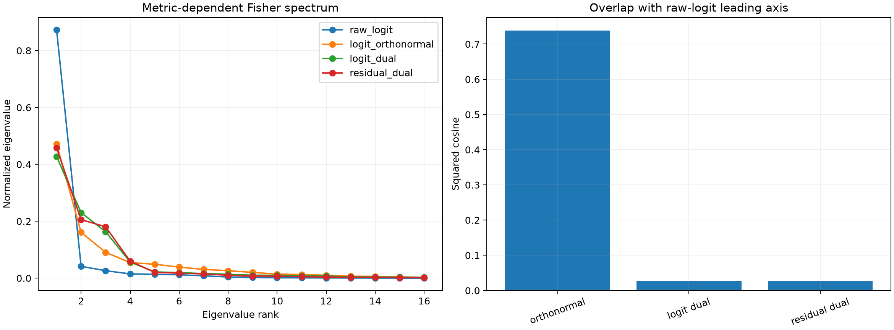

# Metric red team of the output-subspace Fisher outlier

The same rank-16 residual output subspace is transported under four dual metrics: raw logit contrasts `W u`, Euclidean-orthonormal logit contrasts, logit duals satisfying `C^T D = I`, and direct residual-space dual axes after final RMSNorm. This distinguishes dynamic network preference from anisotropy injected by the unembedding metric.

Raw-Fisher leading-axis squared cosine with the weight-only unembedding-Gram leading axis: **0.982**.

## Locked hypotheses

- **W0_raw_fisher_is_unembedding_gain: supported.**
- **W1_residual_metric_removes_raw_outlier: supported.**
- **W2_logit_dual_removes_raw_outlier: supported.**
- **W3_residual_metric_has_shared_structure: supported.**
- **W4_metric_specific_subspaces_transfer: supported.**
- **W5_metric_choice_changes_the_leading_axis: supported.**

| Metric | Eval top1/top4 | Effective rank | Rotation-null top1/top4 p95 | Top1 transfer | Top4 transfer | Raw-leading-axis overlap |
|---|---:|---:|---:|---:|---:|---:|
| raw_logit | 0.873/0.956 | 1.87 | 0.142/0.450 | 0.997 | 0.932 | 1.000 |
| logit_orthonormal | 0.472/0.778 | 6.33 | 0.122/0.398 | 0.972 | 0.955 | 0.739 |
| logit_dual | 0.428/0.878 | 5.46 | 0.123/0.409 | 0.859 | 0.990 | 0.028 |
| residual_dual | 0.458/0.905 | 4.93 | 0.127/0.414 | 0.891 | 0.994 | 0.027 |

## Cross-metric and semantic audit

Raw-logit versus residual-dual top-four subspace overlap: **0.134**. Residual-dual axis semantic AUROC: **0.844**, versus matched-random p95 **0.840**.

| Residual axis | Selected vocabulary label | Promoted examples | Suppressed examples |
|---:|---|---|---|
| 0 | `generic:capitalized` | `[' Presumably', ' Dozens', ' Protesters', ' McCabe']` | `['Supporters', '<?', 'Specifically', 'Parameters']` |
| 1 | `generic:digit` | `['illusion', 'fascist', '░', '=\\"']` | `['WAYS', ')+', ' EDITION', ' DRAGON']` |
| 2 | `coarse:content_word` | `['Lago', 'NSA', 'Nap', 'Ent']` | `[' still', ' being', ' changing', ' falling']` |
| 3 | `generic:alphabetic` | `[' Paul', ' Henry', ' Christian', ' James']` | `[' DISTR', '��', ' SOFTWARE', 'paio']` |

## Guardrails

A Fisher axis is canonical only after choosing a dual metric. Raw logits weight directions by unembedding gain; residual duals weight internal residual coordinates equally; logit duals weight equal coordinates within the reachable logit subspace. None is universally correct. Stable low-dimensional subspace geometry is stronger evidence than naming individual axes, especially when matched rotations explain semantic AUROC equally well.
