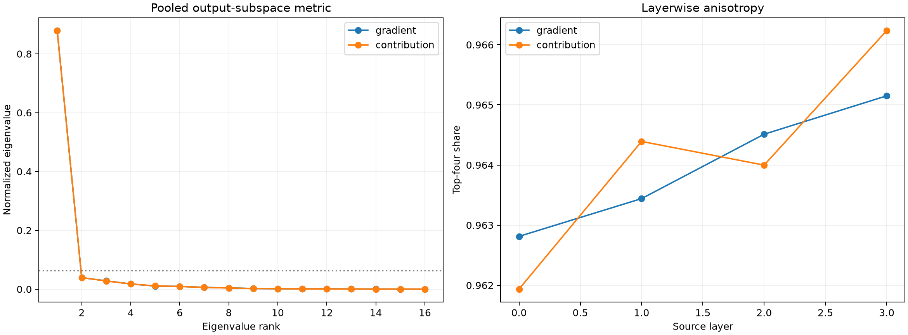

# Rotation-invariant Fisher geometry of the output subspace

Every FineWeb site supplies an exact 16-by-channel tensor map from the stable late output subspace to a Layer-0--3 MLP product. Its normalized Gram matrix is invariant to the reported output basis. Averaging these metrics asks whether the data distribution selects shared important objective directions. A per-context Haar rotation null preserves every local spectrum while destroying shared orientation.

## Locked hypotheses

- **F0_gradient_metric_has_shared_outlier: supported.**
- **F1_gradient_metric_has_low_rank_core: supported.**
- **F2_gradient_axes_are_reproducible: supported.**
- **F3_contribution_metric_has_shared_core: supported.**
- **F4_leading_subspaces_transfer: supported.**
- **F5_fisher_axes_are_semantically_privileged: not supported.**

| Family | Split/eval axis overlap | Top-4 subspace overlap | Eval top1/top4 | Rotation-null p95 top1/top4 | Effective rank | Semantic AUROC/random p95 |
|---|---:|---:|---:|---:|---:|---:|
| gradient | 0.840/0.893 | 0.955 | 0.879/0.964 | 0.098/0.345 | 1.82 | 0.797/0.837 |
| contribution | 0.855/0.886 | 0.937 | 0.879/0.964 | 0.099/0.345 | 1.82 | 0.798/0.837 |

## Per-layer geometry

| Family | Layer | Eval top1/top4 | Effective rank | Discovery/evaluation top4 overlap |
|---|---:|---:|---:|---:|
| gradient | 0 | 0.867/0.963 | 1.90 | 0.932 |
| gradient | 1 | 0.875/0.963 | 1.85 | 0.941 |
| gradient | 2 | 0.884/0.965 | 1.79 | 0.947 |
| gradient | 3 | 0.891/0.965 | 1.74 | 0.962 |
| contribution | 0 | 0.863/0.962 | 1.93 | 0.916 |
| contribution | 1 | 0.879/0.964 | 1.82 | 0.969 |
| contribution | 2 | 0.885/0.964 | 1.78 | 0.922 |
| contribution | 3 | 0.890/0.966 | 1.74 | 0.914 |

## Guardrails

Fisher eigenvectors are canonical only relative to the declared FineWeb distribution, source layers, positions, and output subspace. Nearly equal eigenvalues make individual axes unstable even when a leading subspace transfers. The rotation null asks whether alignment is shared across contexts; it does not supply semantic meaning. Semantic labels are evaluated only after the metric is frozen.
