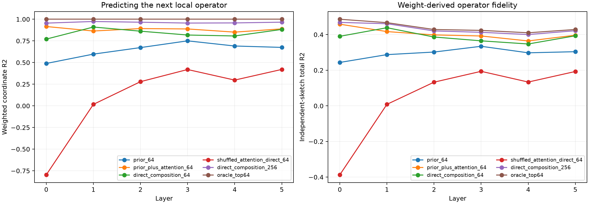

# Prospective cross-layer operator router

Each layer's frozen rank-64 bilinear-operator coordinates are predicted without observing that layer's normalized pre-MLP state. Candidate routers use a compressed prior residual, the same-position attention input, the context-routed attention write, or prior-residual plus attention-write summaries. PCA and ridge fits use discovery FineWeb; evaluation is disjoint FineWeb and a fresh weight-derived operator sketch.

## Locked hypotheses

- **P0_previous_operator_is_markovian: supported.**
- **P1_prior_residual_is_a_compact_router: not supported.**
- **P2_attention_adds_contextual_routing: supported.**
- **P3_rank128_composed_router_recovers_half_oracle: supported.**
- **P4_rank512_composed_router_is_near_oracle: supported.**
- **P5_attention_routing_grows_with_depth: not supported.**
- **P6_direct_rank512_composition_recovers_most_oracle: supported.**
- **P7_attention_pairing_is_specific: supported.**

Each cell is weighted coordinate R2 / total operator R2; parenthesized values are fractions of the rank-64 oracle gain.

| Layer | Prev operator64 | Prior64 | Attn input64 | Prior+attn64 | Direct64 | Shuffled direct64 | Direct256 | Oracle64 |
|---:|---:|---:|---:|---:|---:|---:|---:|---:|
| 0 | — | 0.489/0.244 (0.50) | 0.489/0.244 (0.50) | 0.916/0.458 (0.94) | 0.771/0.390 (0.80) | -0.796/-0.387 (-0.79) | 0.955/0.468 (0.96) | 1.000/0.486 (1.00) |
| 1 | 0.603/0.292 (0.63) | 0.597/0.288 (0.62) | 0.592/0.285 (0.61) | 0.864/0.417 (0.89) | 0.910/0.439 (0.94) | 0.017/0.008 (0.02) | 0.974/0.461 (0.99) | 1.000/0.467 (1.00) |
| 2 | 0.637/0.287 (0.67) | 0.673/0.302 (0.71) | 0.670/0.301 (0.70) | 0.892/0.398 (0.93) | 0.862/0.387 (0.90) | 0.279/0.133 (0.31) | 0.966/0.421 (0.98) | 1.000/0.429 (1.00) |
| 3 | 0.664/0.295 (0.70) | 0.750/0.334 (0.79) | 0.747/0.333 (0.79) | 0.888/0.392 (0.93) | 0.818/0.365 (0.86) | 0.419/0.194 (0.46) | 0.956/0.413 (0.97) | 1.000/0.424 (1.00) |
| 4 | 0.648/0.279 (0.68) | 0.691/0.298 (0.73) | 0.687/0.296 (0.72) | 0.851/0.364 (0.89) | 0.807/0.347 (0.85) | 0.297/0.134 (0.33) | 0.958/0.400 (0.98) | 1.000/0.410 (1.00) |
| 5 | 0.659/0.297 (0.69) | 0.675/0.304 (0.71) | 0.667/0.301 (0.70) | 0.889/0.397 (0.93) | 0.882/0.393 (0.92) | 0.421/0.193 (0.45) | 0.966/0.422 (0.98) | 1.000/0.429 (1.00) |

Attention increment in weighted coordinate R2: `{"0": 0.4267137050628662, "1": 0.2667296528816223, "2": 0.21960300207138062, "3": 0.13744258880615234, "4": 0.1602269411087036, "5": 0.21386438608169556}`.

## Guardrails

The target-fitted ridge routers and the direct algebraic composition answer different questions. Direct64/256 has no fitted map to the target: it reconstructs mixed residual and attention write in discovery-PCA bases, adds them, and applies native RMSNorm. The shuffled control preserves position and both marginal distributions but breaks the sequence-specific pairing. Attention still contains a context aggregation computed by the native attention mechanism, so success localizes the routing interface rather than explaining attention itself. The rank-64 oracle remains a truncation ceiling rather than the full MLP operator.
