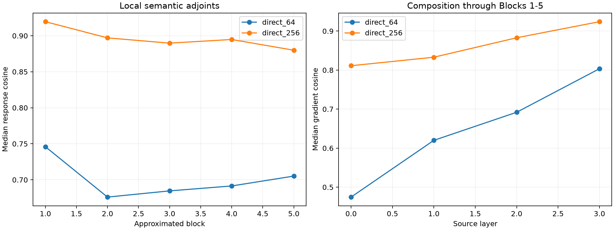

# Causal composition of the prospective operator router

Discovery-frozen PCA bases compress each Block 1--5 mixed residual and attention write separately. At each held-out semantic site, the components are reconstructed, literally added, RMS-normalized, and used as the state conditioning the bilinear MLP Jacobian. No regression to the target operator or intervention effect is fitted. Every attention derivative, other position, and later block remains exact.

Maximum exact residual-plus-attention state reconstruction error: `0.00e+00`.

## Locked hypotheses

- **C0_direct_formula_matches_native_state: supported.**
- **C1_direct64_reconstructs_semantic_local_response: not supported.**
- **C2_direct64_composes_through_suffix: not supported.**
- **C3_direct256_composes_strongly: supported.**
- **C4_direct64_is_finitely_directional: supported.**
- **C5_composition_improves_for_later_sources: supported.**

| Block | Direct64 local cosine | Direct256 local cosine |
|---:|---:|---:|
| 1 | 0.746 | 0.920 |
| 2 | 0.676 | 0.897 |
| 3 | 0.685 | 0.890 |
| 4 | 0.691 | 0.895 |
| 5 | 0.705 | 0.880 |

| Source layer | Direct64 gradient cosine | Direct256 gradient cosine | Direct64 finite direction |
|---:|---:|---:|---:|
| 0 | 0.475 | 0.811 | 0.938 |
| 1 | 0.620 | 0.833 | 1.000 |
| 2 | 0.692 | 0.883 | 1.000 |
| 3 | 0.804 | 0.924 | 1.000 |

## Guardrails

This validates a compact interface between attention and each MLP, not a semantic interpretation of its coordinates. The PCA bases are data-derived and dense. Only Blocks 1--5 are compressed; the remaining suffix is exact. Finite validation tests source-channel selection induced by the approximate gradient, not a forward replacement of every compressed state.
