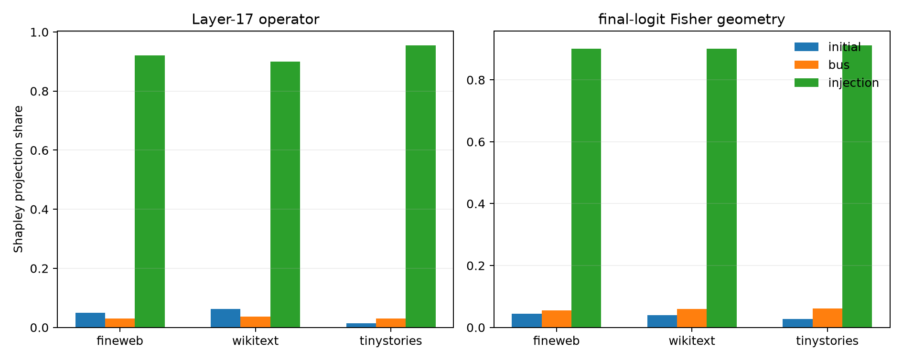

# Repeated-embedding path factorial

A donor current-token embedding is introduced independently through the initial residual, the persistent Layer-0 value bus, and the `x0` injection repeated at every block. `001` means injection only; `010` bus only; `100` initial state only; `111` is the complete donor-token substitution.

## Locked hypotheses

- **X0_factorial_endpoints_are_exact: not supported.** Externally supplied native/donor Layer-0 value buses reproduce ordinary native/donor executions to relative error at most 1e-6.
- **X1_repeated_injection_is_operator_relevant: supported.** With initial state and persistent bus held native, donor x0 injection at all layers reproduces at least 0.50 of the full donor operator effect on every corpus.
- **X2_repeated_injection_is_behavior_relevant: supported.** The injection-only coalition reproduces at least 0.30 of the full donor Fisher-logit effect on every corpus.
- **X3_initial_state_alone_is_not_sufficient: supported.** The initial-state-only coalition has operator and Fisher fidelity below 0.50 on every corpus.
- **X4_persistent_value_bus_is_not_sufficient: supported.** The persistent-bus-only coalition has operator and Fisher fidelity below 0.50 on every corpus.
- **X5_no_single_three_layer_injection_group_is_sufficient: supported.** No isolated three-layer injection group reaches 0.80 operator fidelity to the all-layer injection effect on any corpus.
- **X6_late_injections_are_not_the_whole_history: supported.** Layers 15-17 alone retain at least 0.10 less operator fidelity than all repeated injections on every corpus.
- **X7_injection_shapley_is_positive: supported.** Repeated injection receives positive Shapley projection share in both operator and Fisher geometries on every corpus.
- **X8_pathway_attribution_is_not_metric_invariant: not supported.** At least one source's operator and Fisher Shapley projection shares differ by 0.10 or more on at least one corpus.
- **X9_source_ordering_transfers_ood: not supported.** The ordering of the three Shapley projection shares is identical across corpora separately for operator and Fisher metrics.
- **X10_cross_entropy_does_not_reverse_injection_relevance: supported.** Injection-only CE-effect fidelity is positive on every corpus.

## Source coalitions

| Corpus | endpoint error | coalition | operator | Fisher logits | CE effect | donor-KL recovery |
|---|---:|---|---:|---:|---:|---:|
| fineweb | 1.28e-06 | `100` | -0.007 | 0.001 | -0.003 | 0.018 |
| fineweb | 1.28e-06 | `010` | 0.033 | 0.047 | 0.010 | 0.051 |
| fineweb | 1.28e-06 | `001` | 0.900 | 0.859 | 0.916 | 0.906 |
| fineweb | 1.28e-06 | `110` | 0.031 | 0.056 | 0.008 | 0.074 |
| fineweb | 1.28e-06 | `101` | 0.984 | 0.965 | 0.983 | 0.977 |
| fineweb | 1.28e-06 | `011` | 0.943 | 0.937 | 0.970 | 0.955 |
| wikitext | 1.05e-06 | `100` | 0.019 | 0.005 | 0.003 | 0.015 |
| wikitext | 1.05e-06 | `010` | 0.038 | 0.054 | 0.013 | 0.053 |
| wikitext | 1.05e-06 | `001` | 0.917 | 0.890 | 0.894 | 0.927 |
| wikitext | 1.05e-06 | `110` | 0.055 | 0.059 | 0.014 | 0.076 |
| wikitext | 1.05e-06 | `101` | 0.989 | 0.969 | 0.983 | 0.979 |
| wikitext | 1.05e-06 | `011` | 0.958 | 0.960 | 0.967 | 0.969 |
| tinystories | 1.05e-06 | `100` | -0.000 | 0.006 | -0.002 | 0.013 |
| tinystories | 1.05e-06 | `010` | 0.020 | 0.033 | 0.047 | 0.051 |
| tinystories | 1.05e-06 | `001` | 0.950 | 0.881 | 0.929 | 0.954 |
| tinystories | 1.05e-06 | `110` | 0.020 | 0.037 | 0.046 | 0.069 |
| tinystories | 1.05e-06 | `101` | 0.986 | 0.958 | 0.978 | 0.984 |
| tinystories | 1.05e-06 | `011` | 0.991 | 0.978 | 0.989 | 0.988 |

## Shapley projection shares

| Corpus | metric | initial | persistent bus | repeated injection |
|---|---|---:|---:|---:|
| fineweb | operator | 0.049 | 0.030 | 0.921 |
| fineweb | fisher | 0.045 | 0.055 | 0.901 |
| wikitext | operator | 0.063 | 0.037 | 0.900 |
| wikitext | fisher | 0.039 | 0.059 | 0.901 |
| tinystories | operator | 0.014 | 0.031 | 0.955 |
| tinystories | fisher | 0.027 | 0.062 | 0.912 |

## Injection depth

| Corpus | group | operator | Fisher logits |
|---|---|---:|---:|
| fineweb | 0-2 only | 0.305 | 0.192 |
| fineweb | 3-5 only | 0.015 | 0.016 |
| fineweb | 6-8 only | 0.189 | 0.137 |
| fineweb | 9-11 only | 0.128 | 0.079 |
| fineweb | 12-14 only | 0.071 | 0.051 |
| fineweb | 15-17 only | 0.022 | 0.033 |
| fineweb | prefix_0_2 | 0.305 | 0.192 |
| fineweb | prefix_0_5 | 0.407 | 0.283 |
| fineweb | prefix_0_8 | 0.798 | 0.728 |
| fineweb | prefix_0_11 | 0.973 | 0.938 |
| fineweb | prefix_0_14 | 0.999 | 0.992 |
| fineweb | all | 1.000 | 1.000 |
| wikitext | 0-2 only | 0.334 | 0.326 |
| wikitext | 3-5 only | 0.020 | 0.013 |
| wikitext | 6-8 only | 0.183 | 0.144 |
| wikitext | 9-11 only | 0.104 | 0.095 |
| wikitext | 12-14 only | 0.051 | 0.059 |
| wikitext | 15-17 only | 0.017 | 0.041 |
| wikitext | prefix_0_2 | 0.334 | 0.326 |
| wikitext | prefix_0_5 | 0.423 | 0.410 |
| wikitext | prefix_0_8 | 0.826 | 0.768 |
| wikitext | prefix_0_11 | 0.969 | 0.946 |
| wikitext | prefix_0_14 | 0.998 | 0.993 |
| wikitext | all | 1.000 | 1.000 |
| tinystories | 0-2 only | 0.176 | 0.192 |
| tinystories | 3-5 only | 0.010 | 0.006 |
| tinystories | 6-8 only | 0.174 | 0.071 |
| tinystories | 9-11 only | 0.098 | 0.047 |
| tinystories | 12-14 only | 0.054 | 0.040 |
| tinystories | 15-17 only | 0.018 | 0.029 |
| tinystories | prefix_0_2 | 0.176 | 0.192 |
| tinystories | prefix_0_5 | 0.283 | 0.276 |
| tinystories | prefix_0_8 | 0.837 | 0.747 |
| tinystories | prefix_0_11 | 0.983 | 0.938 |
| tinystories | prefix_0_14 | 0.999 | 0.991 |
| tinystories | all | 1.000 | 1.000 |

## Interpretation boundary

This factorial distinguishes architectural entry paths for one finite token-embedding substitution. It does not make the three paths statistically independent: their nonlinear interactions are allocated by Shapley averaging. Operator and Fisher shares answer different questions and need not agree. Hybrid coalitions are causal interventions, not necessarily states encountered on natural text.
