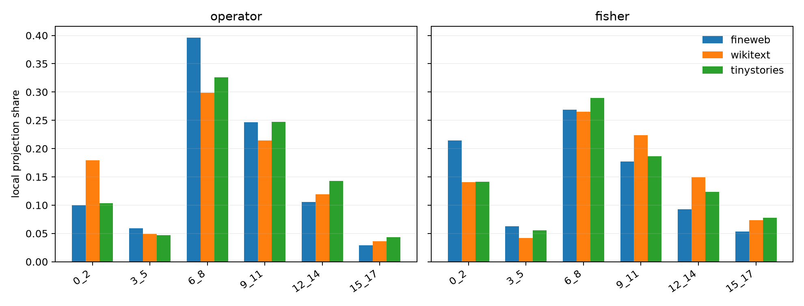

# Repeated-embedding weight-path JVP

Each number is obtained by differentiating the actual weight graph at native text states. The eight independently perturbable aliases are the initial state, persistent value-bus source, and six three-layer `x0` injection groups.

## Locked hypotheses

- **W0_weight_path_jvps_recompose: supported.** The sum of independently derived path JVPs matches the simultaneous token-embedding JVP to relative error at most 1e-5 for operator and logits.
- **W1_one_percent_edit_is_locally_linear: supported.** The total weight JVP reproduces a 0.01x finite edit with at least 0.99 operator and Fisher fidelity on every corpus.
- **W2_full_token_edit_is_materially_nonlinear: supported.** Full-edit operator or Fisher JVP fidelity is at least 0.10 below its 0.01x value on every corpus.
- **W3_repeated_injection_dominates_local_sensitivity: supported.** The six repeated-injection groups jointly receive at least 0.80 projection share in both operator and Fisher geometry on every corpus.
- **W4_initial_and_bus_are_minor_local_paths: supported.** Initial plus bus projection share is at most 0.20 in both operator and Fisher geometry on every corpus.
- **W5_layers_0_through_11_capture_most_local_injection_effect: supported.** Injection groups 0-11 reproduce at least 0.80 of the all-injection local effect in operator and Fisher geometry on every corpus.
- **W6_layers_15_through_17_are_locally_minor: supported.** The Layer-15-17 injection group has absolute projection share at most 0.10 in both metrics on every corpus.
- **W7_injection_dominance_is_metric_robust: supported.** Total injection projection shares differ by at most 0.10 between operator and Fisher metrics on every corpus.
- **W8_injection_dominance_transfers_ood: supported.** Total injection projection share ranges by at most 0.15 across corpora in each metric.
- **W9_true_token_loss_uses_the_injection_path: supported.** Repeated-injection groups receive positive aggregate projection share for the true-token CE derivative on every corpus.
- **W10_equal_direct_coefficients_do_not_imply_equal_path_importance: supported.** The range of three-layer injection-group projection shares is at least 0.10 in at least one metric on every corpus.

## Path projection shares

| Corpus | metric | initial | bus | injection all | inject 0-2/3-5/6-8/9-11/12-14/15-17 |
|---|---|---:|---:|---:|---:|
| fineweb | operator | 0.033 | 0.031 | 0.936 | 0.100/0.059/0.396/0.247/0.106/0.029 |
| fineweb | fisher | 0.078 | 0.053 | 0.870 | 0.215/0.063/0.269/0.177/0.093/0.053 |
| fineweb | cross_entropy | 0.156 | -0.034 | 0.878 | 0.327/0.076/0.185/0.158/0.098/0.034 |
| wikitext | operator | 0.115 | -0.012 | 0.898 | 0.179/0.049/0.299/0.215/0.119/0.036 |
| wikitext | fisher | 0.054 | 0.051 | 0.894 | 0.141/0.042/0.265/0.224/0.149/0.073 |
| wikitext | cross_entropy | 0.078 | -0.009 | 0.930 | 0.158/0.056/0.331/0.222/0.114/0.050 |
| tinystories | operator | 0.024 | 0.067 | 0.910 | 0.103/0.047/0.326/0.247/0.143/0.043 |
| tinystories | fisher | 0.052 | 0.075 | 0.873 | 0.141/0.055/0.289/0.186/0.123/0.078 |
| tinystories | cross_entropy | -0.004 | 0.019 | 0.985 | -0.057/0.014/0.280/0.346/0.260/0.142 |

## Finite radius of the local explanation

| Corpus | scale | operator | Fisher | CE effect |
|---|---:|---:|---:|---:|
| fineweb | 0.01 | 1.000 | 1.000 | 1.000 |
| fineweb | 0.1 | 0.969 | 0.972 | 0.966 |
| fineweb | 1.0 | 0.048 | 0.001 | -0.012 |
| wikitext | 0.01 | 1.000 | 1.000 | 1.000 |
| wikitext | 0.1 | 0.990 | 0.986 | 0.939 |
| wikitext | 1.0 | 0.089 | 0.194 | 0.028 |
| tinystories | 0.01 | 1.000 | 1.000 | 1.000 |
| tinystories | 0.1 | 0.983 | 0.970 | 0.978 |
| tinystories | 1.0 | 0.091 | 0.099 | 0.042 |

## Interpretation boundary

This is the direct weight-and-connection answer for one donor-token tangent at each native state. It removes probe fitting and Shapley-allocation ambiguity locally. It remains conditional on the state, donor direction, and output metric; finite-edit degradation quantifies where that local ontology stops being sufficient.
