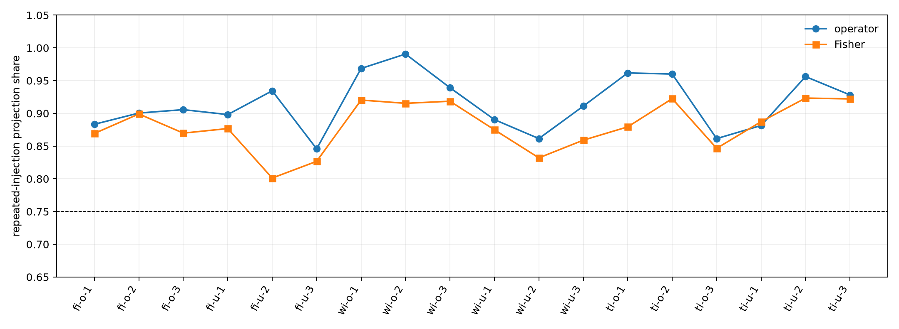

# Repeated-embedding weight-JVP red team

This disjoint replication crosses three corpora, original versus unseen positions, and all three nontrivial within-batch donor permutations.

## Locked hypotheses

- **D0_path_recomposition_survives_controls: supported.** Every cell recomposes operator and logit JVPs to relative error at most 1e-5.
- **D1_injection_dominance_survives_controls: supported.** Repeated injections receive at least 0.75 operator and Fisher projection share in every corpus-position-donor cell.
- **D2_final_group_remains_minor: supported.** The Layer-15-17 injection group has absolute operator and Fisher share at most 0.15 in every cell.
- **D3_middle_groups_are_jointly_material: supported.** Layers 6-11 jointly receive at least 0.30 operator and Fisher projection share in every cell.
- **D4_layer6_8_is_usually_largest_operator_group: supported.** Layers 6-8 are the largest injection group by operator share in at least 80% of cells.
- **D5_donor_pairing_does_not_control_injection_share: supported.** Within each corpus and position group, injection-all share ranges by at most 0.15 across donor shifts in both metrics.
- **D6_position_choice_does_not_control_injection_share: supported.** Within each corpus and donor shift, injection-all share differs by at most 0.15 between original and unseen positions in both metrics.
- **D7_small_edit_linearity_survives_controls: supported.** The 0.01x JVP reaches at least 0.99 operator and Fisher fidelity in every cell.
- **D8_full_edit_nonlinearity_survives_controls: supported.** The 1.0x JVP is at least 0.10 worse than the 0.01x JVP in operator or Fisher fidelity in every cell.
- **D9_operator_and_fisher_agree_on_injection_dominance: supported.** Injection-all projection share differs by at most 0.15 between operator and Fisher metrics in every cell.
- **D10_initial_plus_bus_remains_minor: supported.** Initial plus bus projection share is at most 0.25 in operator and Fisher geometry in every cell.

## Cell summaries

| Corpus | positions | shift | injection operator/Fisher | middle 6-11 operator/Fisher | final 15-17 operator/Fisher | full-edit operator/Fisher |
|---|---|---:|---:|---:|---:|---:|
| fineweb | original | 1 | 0.883/0.869 | 0.497/0.447 | 0.033/0.060 | 0.186/0.130 |
| fineweb | original | 2 | 0.900/0.899 | 0.522/0.431 | 0.023/0.052 | 0.145/0.144 |
| fineweb | original | 3 | 0.906/0.870 | 0.518/0.427 | 0.027/0.057 | 0.132/0.104 |
| fineweb | unseen | 1 | 0.898/0.877 | 0.520/0.517 | 0.023/0.054 | -0.039/0.064 |
| fineweb | unseen | 2 | 0.934/0.801 | 0.533/0.441 | 0.043/0.047 | 0.058/0.131 |
| fineweb | unseen | 3 | 0.846/0.827 | 0.482/0.395 | 0.033/0.058 | -0.009/0.063 |
| wikitext | original | 1 | 0.969/0.920 | 0.688/0.589 | 0.032/0.057 | -0.093/-0.073 |
| wikitext | original | 2 | 0.991/0.915 | 0.726/0.597 | 0.044/0.058 | -0.023/0.086 |
| wikitext | original | 3 | 0.939/0.919 | 0.665/0.584 | 0.035/0.061 | 0.081/0.039 |
| wikitext | unseen | 1 | 0.890/0.875 | 0.497/0.499 | 0.080/0.061 | 0.142/0.042 |
| wikitext | unseen | 2 | 0.861/0.832 | 0.500/0.448 | 0.043/0.050 | 0.247/0.078 |
| wikitext | unseen | 3 | 0.911/0.859 | 0.599/0.532 | 0.051/0.058 | 0.216/0.100 |
| tinystories | original | 1 | 0.962/0.879 | 0.671/0.492 | 0.045/0.064 | 0.142/0.089 |
| tinystories | original | 2 | 0.960/0.922 | 0.587/0.554 | 0.050/0.059 | 0.221/-0.083 |
| tinystories | original | 3 | 0.861/0.847 | 0.528/0.417 | 0.032/0.037 | 0.214/-0.172 |
| tinystories | unseen | 1 | 0.881/0.887 | 0.533/0.490 | 0.035/0.077 | 0.220/0.041 |
| tinystories | unseen | 2 | 0.956/0.923 | 0.610/0.573 | 0.035/0.072 | 0.201/0.041 |
| tinystories | unseen | 3 | 0.928/0.922 | 0.582/0.539 | 0.030/0.080 | 0.177/0.003 |

## Interpretation boundary

Passing these controls would establish a robust local architectural path ordering for ordinary token directions. It would not make the individual three-layer shares semantic modules, nor would it repair the known failure of one native-state JVP to explain a complete token substitution.
