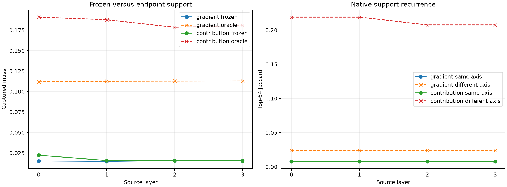

# Do stable residual-Fisher axes reuse fixed native channels?

The residual-dual Fisher basis is frozen from the prior metric experiment. Discovery FineWeb ranks native channels separately for each axis using mean squared gradient or mean squared native activation-weighted contribution. Disjoint FineWeb compares those fixed top-64 lists with each endpoint's own top 64 and with 32 random rotations of the identical output subspace.

## Locked hypotheses

- **R0_fisher_axes_have_privileged_frozen_gradient_support: not supported.**
- **R1_fisher_axes_have_privileged_frozen_contribution_support: not supported.**
- **R2_frozen_support_approaches_endpoint_oracle: not supported.**
- **R3_same_axis_support_recurs: not supported.**
- **R4_leading_axes_are_more_reusable: not supported.**

| Layer | Family | Frozen capture | Endpoint oracle | Frozen/oracle | Same/different Jaccard | Random frozen p95 | Leading4/trailing12 |
|---:|---|---:|---:|---:|---:|---:|---:|
| 0 | gradient | 0.015 | 0.112 | 0.136 | 0.008/0.024 | 0.016 | 0.016/0.015 |
| 0 | contribution | 0.022 | 0.191 | 0.116 | 0.008/0.219 | 0.021 | 0.022/0.022 |
| 1 | gradient | 0.015 | 0.113 | 0.131 | 0.008/0.024 | 0.015 | 0.015/0.015 |
| 1 | contribution | 0.016 | 0.188 | 0.084 | 0.008/0.219 | 0.016 | 0.016/0.016 |
| 2 | gradient | 0.016 | 0.113 | 0.138 | 0.008/0.024 | 0.016 | 0.016/0.016 |
| 2 | contribution | 0.016 | 0.179 | 0.088 | 0.008/0.208 | 0.017 | 0.016/0.016 |
| 3 | gradient | 0.015 | 0.113 | 0.137 | 0.008/0.024 | 0.017 | 0.017/0.015 |
| 3 | contribution | 0.016 | 0.181 | 0.086 | 0.008/0.208 | 0.016 | 0.016/0.015 |

## Guardrails

Fisher axes are stable objective directions under the residual metric. This test asks a different question: whether each objective owns a reusable list of native early channels. A null result does not invalidate the objective subspace; it means stable behavior is executed by context-conditioned coalitions rather than fixed neuron identities.
