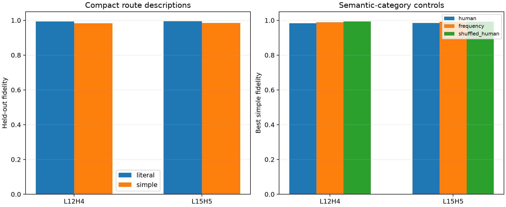

# Large-corpus route atlas for newly implicated late heads

L12H4 and L15H5 were selected only after the semantic construction experiment. Their native QK×QK×OV edge effects are now summarized on two disjoint 98,304-token FineWeb panels using frozen weight-derived operator probes. Human source-token categories are compared with frequency bins and frequency-stratified shuffled labels.

## Locked decisions

- **W0_exact_edge_partitions: supported.** Observed: `1.0174542808272236e-07`
- **W1_selected_route_profiles_replicate: supported.** Observed: `{'L12H4': 0.9968744500936724, 'L15H5': 0.9973210289930701}`
- **W2_selected_heads_have_compact_read_programs: supported.** Observed: `{'L12H4': {'simple': 0.9837499098403837, 'literal': 0.993758669249562}, 'L15H5': {'simple': 0.9848813229691427, 'literal': 0.9946492348717958}}`
- **W3_human_labels_add_information: not supported.** Observed: `{'L12H4': -0.0091657814206485, 'L15H5': -0.007652274390344993}`
- **W4_route_support_is_not_one_literal_lookup: supported.** Observed: `{'L12H4': 0.7777777777777778, 'L15H5': 0.8823529411764706}`

| Head | Joint cosine | Literal fidelity | Best human program | Simple fidelity | Route Jaccard | Leading routes |
|---|---:|---:|---|---:|---:|---|
| L12H4 | 0.997 | 0.994 | rank1 | 0.984 | 0.778 | 8-15/lowercase, 32-127/lowercase, 4-7/lowercase |
| L15H5 | 0.997 | 0.995 | rank1 | 0.985 | 0.882 | 32-127/function_word, 16-31/function_word, 8-15/function_word |

## High-effect held-out edges

### L12H4
- ` Silver` (capitalized, distance 0) → ` Silver`; coefficient `-0.309`; ` 56\n- Sarah Silverman:`
- ` Ken` (capitalized, distance 0) → ` Ken`; coefficient `-0.568`; ` a little exchange with Ken Griffey`
- ` wife` (lowercase, distance 0) → ` wife`; coefficient `-0.302`; ` Valerie Plame, wife of Joseph`
- ` Carly` (suffix, distance 0) → ` Carly`; coefficient `-0.441`; `woman and chief executive Carly Fiorina got`
- ` She` (function_word, distance 0) → ` She`; coefficient `-0.309`; ` in many churches. Shepherds`
- ` Anne` (capitalized, distance 0) → ` Anne`; coefficient `-0.442`; ` there was romance between Anne and Peter`

### L15H5
- ` will` (function_word, distance 2) → ` and`; coefficient `-0.435`; `, the muffins will rise and achieve that`
- ` will` (function_word, distance 8) → ` other`; coefficient `-0.429`; ` the Philadelphia rate You will my welfare pecuniarily and other- them`
- ` started` (suffix, distance 11) → ` listening`; coefficient `-0.511`; ` picture. Our conversation started with listening, followed by asking lots of questions, listening some more`
- ` was` (function_word, distance 25) → ` the`; coefficient `-0.595`; ` Endo are large wasp-like creatures and although they do exhibit some degree of intelligence, it seems to be on a much lower scale than the Pretend`
- ` was` (function_word, distance 7) → ` Speed`; coefficient `-0.485`; ` batteries, the engine was put before the back tire. Speed control put`
- ` will` (function_word, distance 6) → ` and`; coefficient `-0.374`; ` reported.\nSafety will be monitored throughout the study and will be`

## Interpretation boundary

This is a weight-conditioned routing atlas, not a semantic classifier. Stable distance/category structure supports a reusable read verb; failure of human categories to beat controls means the verb may be easier to describe geometrically than linguistically. High-effect examples illustrate the frozen operator profile and are not independent validation of a semantic name.
