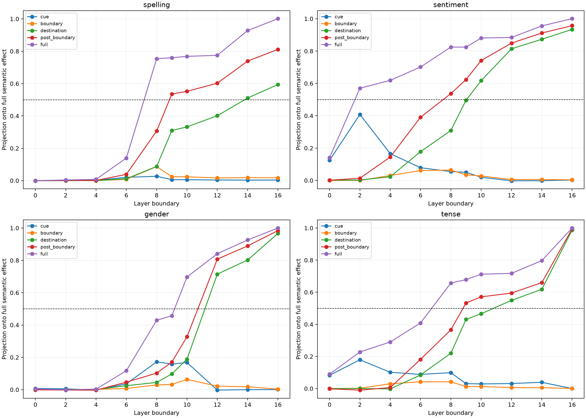

# Depth and spatial localization of transferable semantic carriers

Natural cue swaps are replayed from ten layer boundaries. At each boundary, the counterfactual residual is transplanted either at the cue, latest boundary, destination, post-boundary field, or full sequence. Repeated embedding and persistent Layer-0 value-bus changes are independently retained or removed. The output contrast uses disjoint lexical pairs from the same family.

## Locked results

- **L0_hybrid_recomposition_is_exact: supported.**
- **L1_spelling_reaches_boundary_state: not supported.**
- **L2_other_variables_reach_destination_state: supported.**
- **L3_full_residual_internalizes_transfer: not supported.**
- **L4_external_carriers_decline: not supported.**
- **L5_spelling_boundary_path_is_exceptional: not supported.**

## Earliest layer reaching 0.50 projection

| Family | Cue | Boundary | Destination | Post-boundary | Full residual |
|---|---:|---:|---:|---:|---:|
| spelling | — | — | 14 | 9 | 8 |
| sentiment | — | — | 10 | 8 | 2 |
| gender | — | — | 12 | 12 | 10 |
| tense | — | — | 12 | 9 | 8 |

## Projection-share curves

### spelling

| Layer | Cue | Boundary | Destination | Post-boundary | Full residual | Embedding | Value bus |
|---:|---:|---:|---:|---:|---:|---:|---:|
| 0 | -0.001 | -0.000 | -0.000 | 0.000 | -0.000 | 0.078 | 0.796 |
| 2 | 0.000 | 0.000 | 0.000 | 0.001 | 0.004 | 0.069 | 0.793 |
| 4 | 0.002 | 0.000 | 0.000 | 0.001 | 0.008 | 0.065 | 0.787 |
| 6 | 0.020 | 0.008 | 0.012 | 0.039 | 0.140 | 0.025 | 0.592 |
| 8 | 0.027 | 0.087 | 0.088 | 0.307 | 0.754 | 0.006 | 0.201 |
| 9 | 0.006 | 0.024 | 0.310 | 0.535 | 0.760 | 0.003 | 0.200 |
| 10 | 0.006 | 0.024 | 0.332 | 0.552 | 0.768 | 0.002 | 0.194 |
| 12 | 0.004 | 0.017 | 0.401 | 0.602 | 0.775 | 0.001 | 0.190 |
| 14 | 0.003 | 0.018 | 0.511 | 0.739 | 0.928 | 0.000 | 0.062 |
| 16 | 0.004 | 0.018 | 0.594 | 0.812 | 1.001 | 0.000 | -0.001 |

### sentiment

| Layer | Cue | Boundary | Destination | Post-boundary | Full residual | Embedding | Value bus |
|---:|---:|---:|---:|---:|---:|---:|---:|
| 0 | 0.124 | -0.000 | 0.001 | 0.001 | 0.141 | 0.243 | 0.278 |
| 2 | 0.408 | -0.000 | 0.003 | 0.013 | 0.570 | 0.031 | 0.260 |
| 4 | 0.166 | 0.030 | 0.023 | 0.145 | 0.619 | 0.026 | 0.248 |
| 6 | 0.079 | 0.061 | 0.178 | 0.391 | 0.702 | 0.010 | 0.207 |
| 8 | 0.055 | 0.064 | 0.309 | 0.537 | 0.825 | 0.001 | 0.121 |
| 9 | 0.050 | 0.034 | 0.495 | 0.624 | 0.824 | 0.001 | 0.125 |
| 10 | 0.020 | 0.028 | 0.617 | 0.742 | 0.881 | -0.000 | 0.081 |
| 12 | -0.002 | 0.005 | 0.814 | 0.849 | 0.884 | -0.000 | 0.078 |
| 14 | -0.002 | 0.005 | 0.873 | 0.912 | 0.956 | -0.000 | 0.027 |
| 16 | 0.003 | 0.004 | 0.934 | 0.957 | 1.000 | 0.000 | -0.000 |

### gender

| Layer | Cue | Boundary | Destination | Post-boundary | Full residual | Embedding | Value bus |
|---:|---:|---:|---:|---:|---:|---:|---:|
| 0 | 0.008 | -0.000 | 0.000 | -0.001 | 0.005 | 0.108 | 0.609 |
| 2 | 0.005 | 0.000 | -0.000 | -0.002 | -0.001 | 0.067 | 0.602 |
| 4 | -0.002 | 0.002 | 0.001 | -0.003 | 0.003 | 0.064 | 0.593 |
| 6 | 0.036 | 0.008 | 0.025 | 0.047 | 0.117 | 0.043 | 0.482 |
| 8 | 0.172 | 0.029 | 0.045 | 0.103 | 0.429 | 0.018 | 0.362 |
| 9 | 0.158 | 0.032 | 0.098 | 0.170 | 0.457 | 0.011 | 0.356 |
| 10 | 0.168 | 0.063 | 0.189 | 0.328 | 0.697 | 0.006 | 0.223 |
| 12 | -0.003 | 0.022 | 0.715 | 0.808 | 0.841 | 0.000 | 0.137 |
| 14 | -0.000 | 0.018 | 0.802 | 0.889 | 0.926 | 0.000 | 0.058 |
| 16 | 0.001 | 0.003 | 0.967 | 0.984 | 1.000 | 0.000 | -0.000 |

### tense

| Layer | Cue | Boundary | Destination | Post-boundary | Full residual | Embedding | Value bus |
|---:|---:|---:|---:|---:|---:|---:|---:|
| 0 | 0.083 | -0.000 | 0.000 | -0.001 | 0.090 | 0.214 | 0.442 |
| 2 | 0.179 | 0.002 | -0.000 | -0.010 | 0.228 | 0.114 | 0.441 |
| 4 | 0.101 | 0.030 | -0.002 | 0.006 | 0.290 | 0.106 | 0.420 |
| 6 | 0.088 | 0.042 | 0.085 | 0.182 | 0.409 | 0.052 | 0.386 |
| 8 | 0.099 | 0.042 | 0.220 | 0.366 | 0.657 | 0.016 | 0.255 |
| 9 | 0.031 | 0.012 | 0.431 | 0.533 | 0.679 | 0.009 | 0.249 |
| 10 | 0.029 | 0.013 | 0.466 | 0.571 | 0.712 | 0.007 | 0.222 |
| 12 | 0.031 | 0.006 | 0.549 | 0.595 | 0.718 | 0.004 | 0.223 |
| 14 | 0.039 | 0.006 | 0.618 | 0.660 | 0.797 | 0.001 | 0.165 |
| 16 | -0.000 | 0.001 | 0.987 | 0.995 | 1.000 | -0.000 | 0.000 |

## Guardrails

A residual transplant is a sufficiency test under the original suffix, not a declaration that the patched positions exclusively store the variable. Projection shares are not additive because the spatial programs overlap and interact nonlinearly with embedding reinjection and the value bus. A cue-only success can be literal lexical transport; boundary/destination success is stronger evidence that the edit has been contextualized, but semantic naming still rests on disjoint-pair behavioral transfer.
