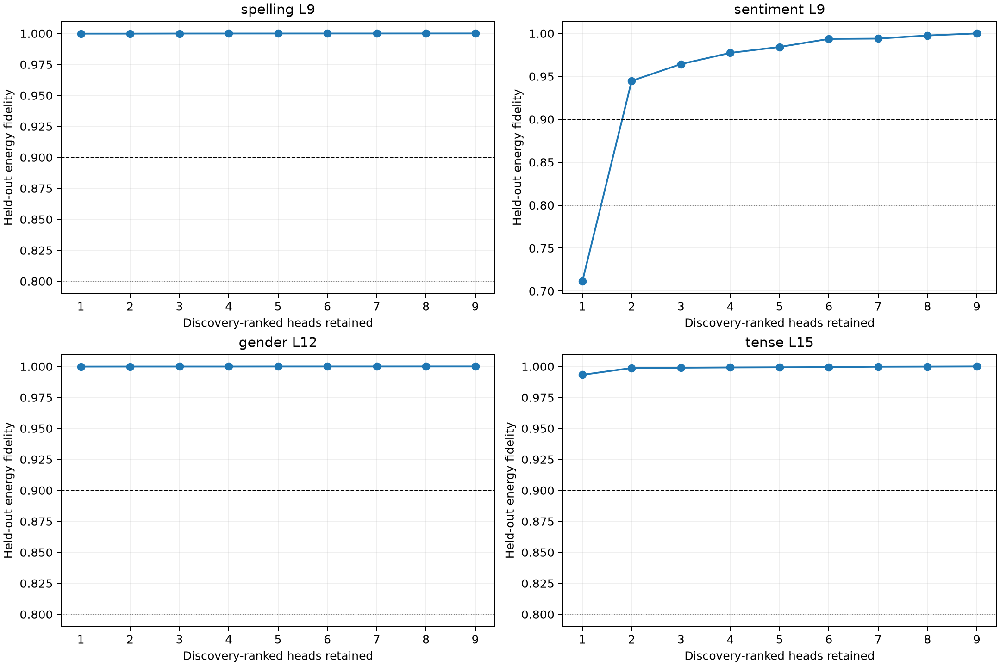

# Compact head programs for semantic construction pulses

Four attention pulses were frozen from the earlier destination-construction experiment. Heads are ranked by absolute finite singleton projection on fold-0/split-0 only. Cumulative programs are then evaluated on the other split and reversed lexical fold through the complete nonlinear suffix.

## Locked decisions

- **H0_head_sum_is_exact: supported.** Observed: `{'state_max_abs': 0.0012359619140625, 'logit_max_abs': 2.6941299438476562e-05}`
- **H1_top3_is_often_sufficient: supported.** Observed: `{'spelling': 0.9999229121006042, 'sentiment': 0.9643369960822379, 'gender': 0.9999253332435248, 'tense': 0.998965320916294}`
- **H2_attention_programs_are_compact: supported.** Observed: `{'spelling': 1.0, 'sentiment': 2.0, 'gender': 1.0, 'tense': 1.0}`
- **H3_programs_transfer_across_lexical_folds: supported.** Observed: `{'spelling': 0.9998344717097107, 'sentiment': 0.9447404345167421, 'gender': 0.9998839589095585, 'tense': 0.9932487004192363}`
- **H4_no_single_universal_construction_head: supported.** Observed: `{'spelling': 8, 'sentiment': 7, 'gender': 4, 'tense': 5}`

| Family/site | Discovery head order | Discovery k90 | Held-out k90 | Held-out top-3 fidelity | Frozen-program fidelity |
|---|---|---:|---:|---:|---:|
| spelling L9 | H8, H7, H2, H5, H3, H0, H1, H4, H6 | 1 | 1.0 | 1.000 | 1.000 |
| sentiment L9 | H7, H1, H3, H4, H6, H8, H0, H5, H2 | 2 | 2.0 | 0.964 | 0.945 |
| gender L12 | H4, H1, H3, H7, H2, H0, H8, H6, H5 | 1 | 1.0 | 1.000 | 1.000 |
| tense L15 | H5, H1, H2, H0, H4, H7, H3, H6, H8 | 1 | 1.0 | 0.999 | 0.993 |

## Guardrails

The program reconstructs the finite attention branch at one selected semantic site; it is not a claim that each selected head has one semantic meaning. Ranking uses the declared output contrast on one discovery cell, while the lexical-fold and corpus-split cells are held out. Absolute singleton ranking includes both supportive and suppressive heads, and k90 is reconstruction fidelity rather than a count of independently meaningful modules.
