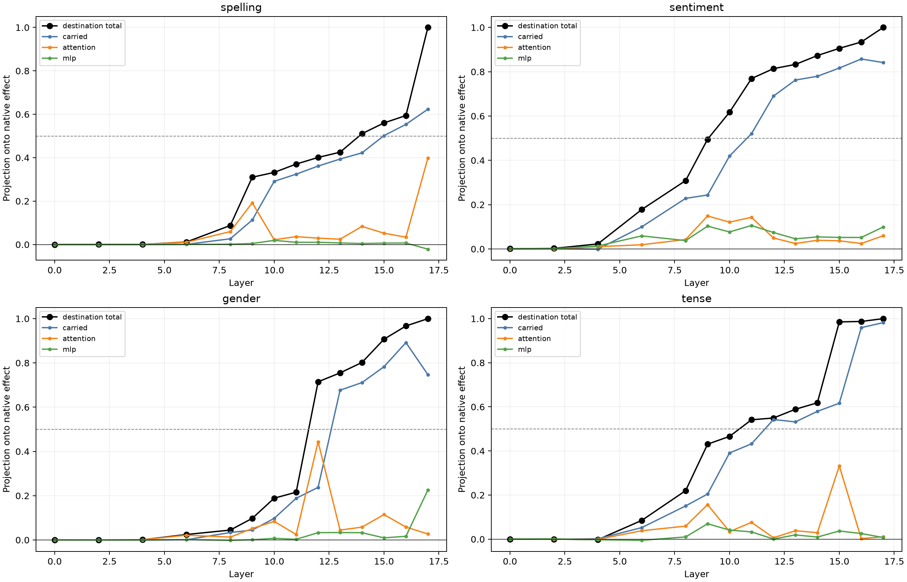

# Construction of destination-aligned semantic variables

At each audited block, the changed destination state is decomposed exactly into carried/reinjected state, fresh attention write, and realized bilinear-MLP write. All eight finite coalitions pass through the untouched nonlinear suffix. Shapley values allocate interactions and are measured against the complete native semantic counterfactual.

## Locked decisions

- **C0_exact_finite_factorial: not supported.** Observed: `{'state': 2.6654261091607623e-05, 'shapley': 2.0824380442263646e-07, 'base': 5.7220458984375e-05}`
- **C1_fresh_attention_constructs_some_crossing_variables: not supported.** Observed: `{'spelling': 0.08358486882783382, 'sentiment': 0.1209652784934281, 'gender': 0.44385243042220957, 'tense': 0.07629774724062251}`
- **C2_mlp_is_usually_a_consolidator_not_primary_source: supported.** Observed: `{'spelling': 0.004641388838564295, 'sentiment': 0.07680447695657514, 'gender': 0.03315560469652364, 'tense': 0.03280506657230683}`
- **C3_terminal_interface_is_carried: supported.** Observed: `{'spelling': 0.6232824459308018, 'sentiment': 0.8414225354202354, 'gender': 0.74703903124154, 'tense': 0.9819264524901233}`
- **C4_branch_credit_is_interaction_robust: supported.** Observed: `1.0`

## First audited destination crossing

| Family | Layer | Destination | Carried | Attention | MLP |
|---|---:|---:|---:|---:|---:|
| spelling | 14 | 0.511 | 0.422 | 0.084 | 0.005 |
| sentiment | 10 | 0.617 | 0.420 | 0.121 | 0.077 |
| gender | 12 | 0.715 | 0.238 | 0.444 | 0.033 |
| tense | 11 | 0.541 | 0.432 | 0.076 | 0.033 |

## Layerwise destination projection and branch allocation

### spelling

| Layer | Destination | Carried | Attention | MLP |
|---:|---:|---:|---:|---:|
| 0 | -0.000 | 0.000 | 0.000 | -0.000 |
| 2 | 0.000 | 0.000 | 0.000 | 0.000 |
| 4 | 0.000 | 0.000 | 0.000 | -0.000 |
| 6 | 0.012 | 0.001 | 0.010 | 0.000 |
| 8 | 0.088 | 0.026 | 0.060 | 0.002 |
| 9 | 0.310 | 0.113 | 0.192 | 0.005 |
| 10 | 0.332 | 0.291 | 0.022 | 0.019 |
| 11 | 0.371 | 0.324 | 0.036 | 0.010 |
| 12 | 0.401 | 0.361 | 0.029 | 0.010 |
| 13 | 0.425 | 0.394 | 0.024 | 0.007 |
| 14 | 0.511 | 0.422 | 0.084 | 0.005 |
| 15 | 0.560 | 0.502 | 0.052 | 0.006 |
| 16 | 0.594 | 0.554 | 0.034 | 0.007 |
| 17 | 1.000 | 0.623 | 0.398 | -0.021 |

### sentiment

| Layer | Destination | Carried | Attention | MLP |
|---:|---:|---:|---:|---:|
| 0 | 0.001 | 0.000 | -0.000 | 0.001 |
| 2 | 0.002 | 0.001 | 0.001 | 0.001 |
| 4 | 0.023 | -0.001 | 0.010 | 0.013 |
| 6 | 0.178 | 0.100 | 0.019 | 0.059 |
| 8 | 0.309 | 0.228 | 0.043 | 0.038 |
| 9 | 0.495 | 0.244 | 0.149 | 0.103 |
| 10 | 0.617 | 0.420 | 0.121 | 0.077 |
| 11 | 0.769 | 0.520 | 0.143 | 0.106 |
| 12 | 0.814 | 0.690 | 0.050 | 0.074 |
| 13 | 0.833 | 0.762 | 0.025 | 0.046 |
| 14 | 0.873 | 0.779 | 0.039 | 0.054 |
| 15 | 0.906 | 0.817 | 0.037 | 0.052 |
| 16 | 0.934 | 0.858 | 0.025 | 0.052 |
| 17 | 1.000 | 0.841 | 0.059 | 0.099 |

### gender

| Layer | Destination | Carried | Attention | MLP |
|---:|---:|---:|---:|---:|
| 0 | 0.000 | 0.000 | -0.000 | 0.000 |
| 2 | -0.000 | -0.000 | 0.000 | -0.000 |
| 4 | 0.001 | 0.000 | 0.001 | -0.000 |
| 6 | 0.025 | 0.001 | 0.022 | 0.002 |
| 8 | 0.045 | 0.034 | 0.013 | -0.002 |
| 9 | 0.098 | 0.045 | 0.052 | 0.001 |
| 10 | 0.189 | 0.098 | 0.084 | 0.007 |
| 11 | 0.216 | 0.188 | 0.025 | 0.003 |
| 12 | 0.715 | 0.238 | 0.444 | 0.033 |
| 13 | 0.755 | 0.677 | 0.045 | 0.034 |
| 14 | 0.802 | 0.711 | 0.058 | 0.033 |
| 15 | 0.907 | 0.783 | 0.115 | 0.009 |
| 16 | 0.967 | 0.892 | 0.058 | 0.017 |
| 17 | 1.000 | 0.747 | 0.027 | 0.226 |

### tense

| Layer | Destination | Carried | Attention | MLP |
|---:|---:|---:|---:|---:|
| 0 | 0.000 | 0.000 | 0.000 | 0.000 |
| 2 | -0.000 | -0.001 | -0.000 | 0.001 |
| 4 | -0.002 | 0.002 | -0.001 | -0.003 |
| 6 | 0.085 | 0.052 | 0.038 | -0.006 |
| 8 | 0.220 | 0.151 | 0.059 | 0.010 |
| 9 | 0.431 | 0.204 | 0.156 | 0.070 |
| 10 | 0.466 | 0.391 | 0.034 | 0.041 |
| 11 | 0.541 | 0.432 | 0.076 | 0.033 |
| 12 | 0.549 | 0.542 | 0.006 | 0.001 |
| 13 | 0.589 | 0.532 | 0.038 | 0.019 |
| 14 | 0.618 | 0.579 | 0.029 | 0.009 |
| 15 | 0.985 | 0.616 | 0.332 | 0.037 |
| 16 | 0.987 | 0.959 | 0.003 | 0.025 |
| 17 | 1.000 | 0.982 | 0.011 | 0.007 |

## Interpretation boundary

The components are additive changes in the realized destination state, not independent mechanisms: the changed MLP write was itself computed from changed carried and attention inputs. Finite Shapley values give an exact symmetric allocation for the declared output contrast, while singleton comparisons expose interaction sensitivity. A large carried share means the current block preserves an already available destination variable; it does not identify the earlier layer or path that created it.
