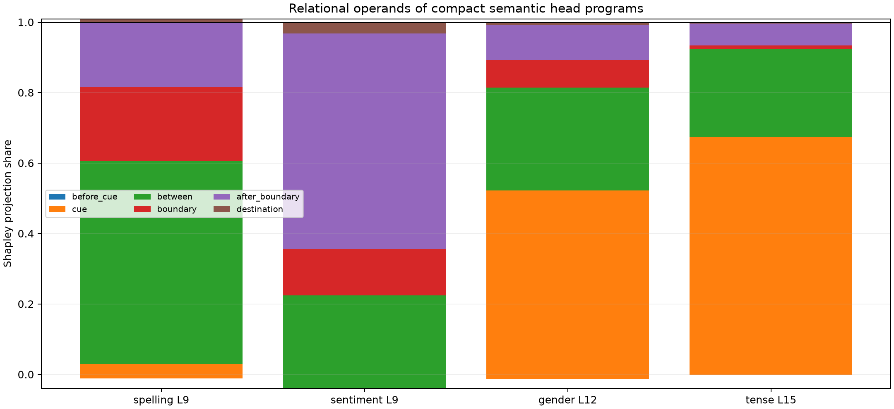

# Operand grammar and QK/value factorial of semantic construction heads

Each frozen head program's exact destination write is split into six disjoint source-position roles using the tensor attention edge product. All 64 role coalitions pass through the nonlinear suffix for exact Shapley allocation. A second 2×2 factorial separates changed QK routing from changed contextual values.

## Locked decisions

- **E0_edge_factorials_are_exact: supported.** Observed: `{'state_max_abs': 2.288818359375e-05, 'group_shapley_relative': 3.14671552814616e-07, 'qkv_shapley_relative': 9.434232595140202e-08}`
- **E1_programs_read_localized_operand_roles: supported.** Observed: `{'spelling': 0.5753262280217257, 'sentiment': 0.6117668514870722, 'gender': 0.5349662998591583, 'tense': 0.6755117903694324}`
- **E2_spelling_is_boundary_exceptional: not supported.** Observed: `{'sentiment': 0.07998375878562294, 'gender': 0.13282323132646723, 'tense': 0.20217311260809762}`
- **E3_operand_grammars_transfer: supported.** Observed: `{'spelling': 0.9930508951000717, 'sentiment': 0.8892815116881931, 'gender': 0.9443965767416647, 'tense': 0.9532341974568215}`
- **E4_contextual_value_change_usually_dominates: supported.** Observed: `{'spelling': {'routing': -0.07199050760566708, 'value': 1.0719904015964057}, 'sentiment': {'routing': 0.019783016034274906, 'value': 0.9802064200678446}, 'gender': {'routing': -0.024629785971765544, 'value': 1.0246306510109535}, 'tense': {'routing': -0.04806296564668732, 'value': 1.048068304877171}}`

| Family/site | Program | Before cue | Cue | Between | Boundary | After boundary | Destination | Routing | Value | Profile stability |
|---|---|---:|---:|---:|---:|---:|---:|---:|---:|---:|
| spelling L9 | H8 | -0.011 | 0.041 | 0.575 | 0.212 | 0.193 | -0.009 | -0.072 | 1.072 | 0.993 |
| sentiment L9 | H7, H1 | -0.001 | -0.039 | 0.264 | 0.132 | 0.612 | 0.032 | 0.020 | 0.980 | 0.889 |
| gender L12 | H4 | -0.013 | 0.535 | 0.293 | 0.079 | 0.098 | 0.008 | -0.025 | 1.025 | 0.944 |
| tense L15 | H5 | -0.003 | 0.676 | 0.251 | 0.009 | 0.062 | 0.004 | -0.048 | 1.048 | 0.953 |

## Interpretation boundary

A source role is a relational operand in these counterfactual contexts, not a semantic label for every token state the head can read. QK and value changes are endogenous to the same upstream edit; Shapley allocation answers which changed tensor factor expresses the finite program effect, not which parameter independently caused it. Stable role profiles support reusable invocation grammar, while semantic payload still requires held-out behavioral transfer.
