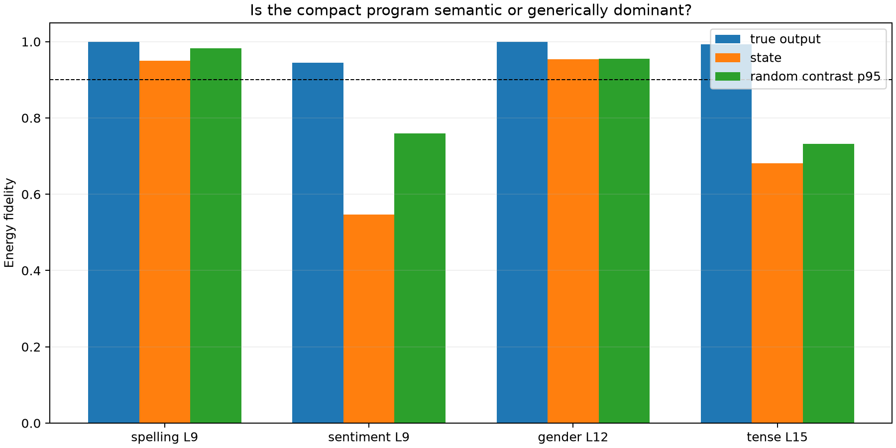

# Specificity red team for compact semantic head programs

Frozen construction-head programs are compared with their reconstruction of the complete attention-state change and with 32 random vocabulary contrasts matched for support size and coefficient norm. Every score below uses the three held-out fold/split cells.

## Locked decisions

- **R0_program_is_state_dominant: not supported.** Observed: `{'spelling': 0.9502477760505234, 'sentiment': 0.5473541548113489, 'gender': 0.9542966938401737, 'tense': 0.6812298176032985}`
- **R1_semantic_contrast_is_exceptional: supported.** Observed: `{'spelling': 0.016742891705260443, 'sentiment': 0.18509978261850057, 'gender': 0.044567268265787385, 'tense': 0.26099722142009785}`
- **R2_discovery_head_remains_best_heldout: supported.** Observed: `{'spelling': {'discovery': 8, 'heldout': 8}, 'sentiment': {'discovery': 7, 'heldout': 7}, 'gender': {'discovery': 4, 'heldout': 4}, 'tense': {'discovery': 5, 'heldout': 5}}`
- **R3_layer9_heads_are_family_specific: supported.** Observed: `{'spelling_H8_minus_H7': 0.9978689258923266, 'sentiment_H7_minus_H8': 0.6582098491894333}`

| Family/site | Program | True output fidelity | State fidelity | Null median | Null p95 | True − null p95 |
|---|---|---:|---:|---:|---:|---:|
| spelling L9 | H8 | 1.000 | 0.950 | 0.964 | 0.983 | +0.017 |
| sentiment L9 | H7, H1 | 0.945 | 0.547 | 0.615 | 0.760 | +0.185 |
| gender L12 | H4 | 1.000 | 0.954 | 0.898 | 0.955 | +0.045 |
| tense L15 | H5 | 0.993 | 0.681 | 0.512 | 0.732 | +0.261 |

## Interpretation boundary

High state fidelity means the program dominates the entire attention-write change, so semantic output fidelity is not evidence that the head is itself semantically specialized. Conversely, low state fidelity with exceptional true-contrast fidelity would indicate output-selective routing. The random contrasts are matched sparse vocabulary objectives, not natural alternative tasks; they diagnose generic output dominance but do not exhaust possible semantic controls.
