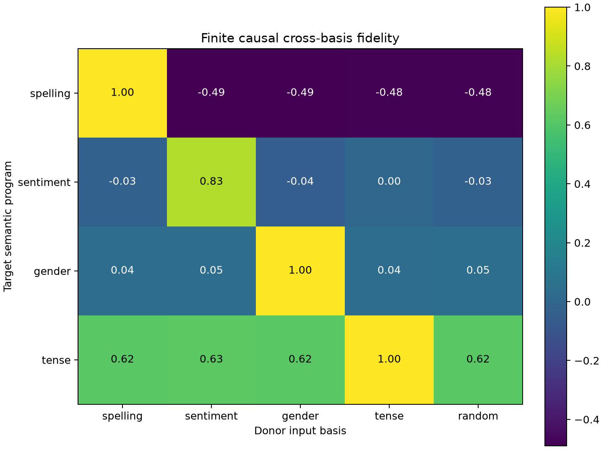

# Cross-family reuse of weight-derived semantic payload bases

Each family supplies an eight-dimensional residual-input basis from the leading left singular modes of its frozen OV program. Every basis is applied to every target family's changed residual states while retaining that target's heads, routing, output map, bus change, and nonlinear suffix. This tests coordinate reuse rather than swapping whole circuits.

## Locked decisions

- **B0_own_weight_basis_is_sufficient: not supported.** Observed: `{'spelling': 0.9996027696485923, 'sentiment': 0.8271507580435931, 'gender': 0.9999858441996707, 'tense': 0.9997535009140156}`
- **B1_payload_bases_are_family_specific: supported.** Observed: `{'spelling': 1.4811959871866387, 'sentiment': 0.8249633553903755, 'gender': 0.95449809492384, 'tense': 0.37314775352328333}`
- **B2_payload_input_subspaces_are_geometrically_distinct: supported.** Observed: `{'spelling': {'spelling': 1.0, 'sentiment': 0.00862046703696251, 'gender': 0.009119020774960518, 'tense': 0.004993582144379616}, 'sentiment': {'spelling': 0.00862046703696251, 'sentiment': 0.9999998807907104, 'gender': 0.006914825178682804, 'tense': 0.06287823617458344}, 'gender': {'spelling': 0.009119019843637943, 'sentiment': 0.006914825178682804, 'gender': 1.0, 'tense': 0.003694225801154971}, 'tense': {'spelling': 0.004993582610040903, 'sentiment': 0.06287823617458344, 'gender': 0.003694225801154971, 'tense': 0.9999999403953552}}`
- **B3_geometric_overlap_predicts_causal_cross_capture: not supported.** Observed: `0.26864028542178997`
- **B4_own_bases_beat_random: supported.** Observed: `{'spelling': 1.4801684424926274, 'sentiment': 0.8537527598926976, 'gender': 0.9522847098098268, 'tense': 0.3833776674306031}`

## Causal cross-capture

| Target \ donor | spelling | sentiment | gender | tense | random |
|---|---:|---:|---:|---:|---:|
| spelling | 1.000 | -0.490 | -0.486 | -0.482 | -0.481 |
| sentiment | -0.029 | 0.827 | -0.042 | 0.002 | -0.027 |
| gender | 0.045 | 0.045 | 1.000 | 0.042 | 0.048 |
| tense | 0.619 | 0.627 | 0.618 | 1.000 | 0.616 |

## Geometric projector overlap

| Basis | spelling | sentiment | gender | tense |
|---|---:|---:|---:|---:|
| spelling | 1.000 | 0.009 | 0.009 | 0.005 |
| sentiment | 0.009 | 1.000 | 0.007 | 0.063 |
| gender | 0.009 | 0.007 | 1.000 | 0.004 |
| tense | 0.005 | 0.063 | 0.004 | 1.000 |

## Interpretation boundary

Diagonal superiority would support family-specific residual payload coordinates; broad cross-capture would support a shared generic payload basis. These are weight-derived input modes of selected OV maps, not globally semantic directions. Cross-layer comparison is meaningful because all blocks share the residual coordinate system, but layerwise normalization and state distributions can still change how the same direction is occupied.
