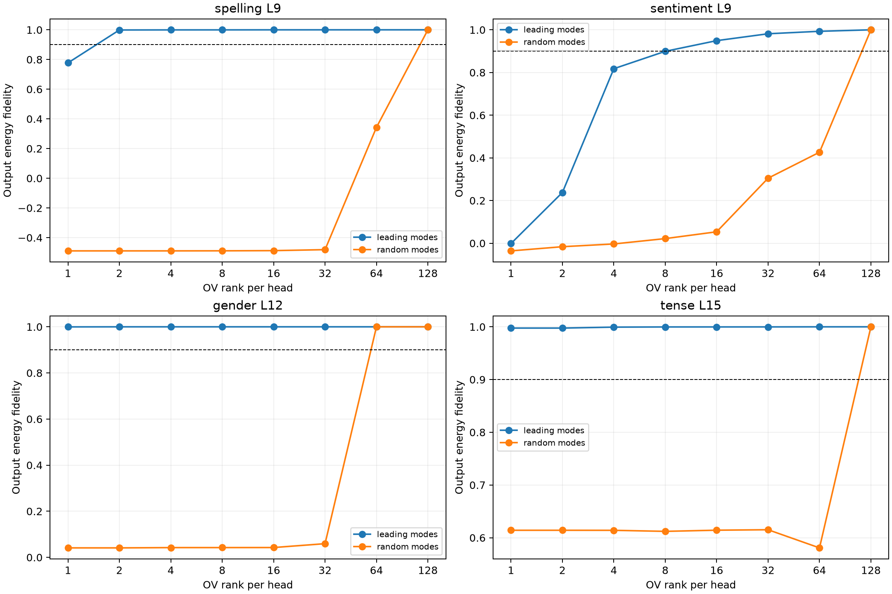

# Weight-derived low-rank compression of semantic value payloads

For each frozen semantic construction program, the current-value OV map is decomposed by SVD using weights only. Leading singular modes and matched random singular modes reconstruct the changed current-value payload while retaining exact routing and persistent-bus change. A separate finite factorial allocates routing, current-value, and persistent-bus changes.

## Locked decisions

- **V0_full_rank_recomposes: not supported.** Observed: `{'max_rank_logit_abs': 0.0002627372741699219, 'factor_shapley_relative': 1.5816290499515162e-07}`
- **V1_rank4_payload_is_often_sufficient: supported.** Observed: `{'spelling': 0.999455777168506, 'sentiment': 0.8178564787421195, 'gender': 0.9999833088272799, 'tense': 0.9994143023466047}`
- **V2_payload_programs_are_low_rank: supported.** Observed: `{'spelling': 2, 'sentiment': 16, 'gender': 1, 'tense': 1}`
- **V3_weight_outliers_beat_random_modes: supported.** Observed: `{'spelling': 1.48841165776517, 'sentiment': 0.8211655778485389, 'gender': 0.957655306363725, 'tense': 0.3853574288922542}`
- **V4_current_values_not_persistent_bus_dominate: supported.** Observed: `{'spelling': {'routing': -0.07199805133188605, 'current': 1.071034566329414, 'bus': 0.0009635093015487762}, 'sentiment': {'routing': 0.01976049505104035, 'current': 0.9743083018289164, 'bus': 0.005931251839715485}, 'gender': {'routing': -0.024000338033577165, 'current': 0.8373614047444335, 'bus': 0.18663894760521685}, 'tense': {'routing': -0.04804042065195932, 'current': 0.5459080808900268, 'bus': 0.5021323829892556}}`

| Family/site | Program | k90/head | Rank-4 top | Rank-4 random | Routing | Current value | Bus |
|---|---|---:|---:|---:|---:|---:|---:|
| spelling L9 | H8 | 2 | 0.999 | -0.489 | -0.072 | 1.071 | 0.001 |
| sentiment L9 | H7, H1 | 16 | 0.818 | -0.003 | 0.020 | 0.974 | 0.006 |
| gender L12 | H4 | 1 | 1.000 | 0.042 | -0.024 | 0.837 | 0.187 |
| tense L15 | H5 | 1 | 0.999 | 0.614 | -0.048 | 0.546 | 0.502 |

## Interpretation boundary

Low rank here means that a few large singular modes of the native OV tensor suffice for this finite semantic payload under the original suffix. It does not make those modes uniquely semantic: singular modes are weight-defined capabilities and may carry unrelated payloads elsewhere. Random-mode controls test spectral ordering, while the routing/current/bus factorial distinguishes architectural carriers at the selected invocation.
