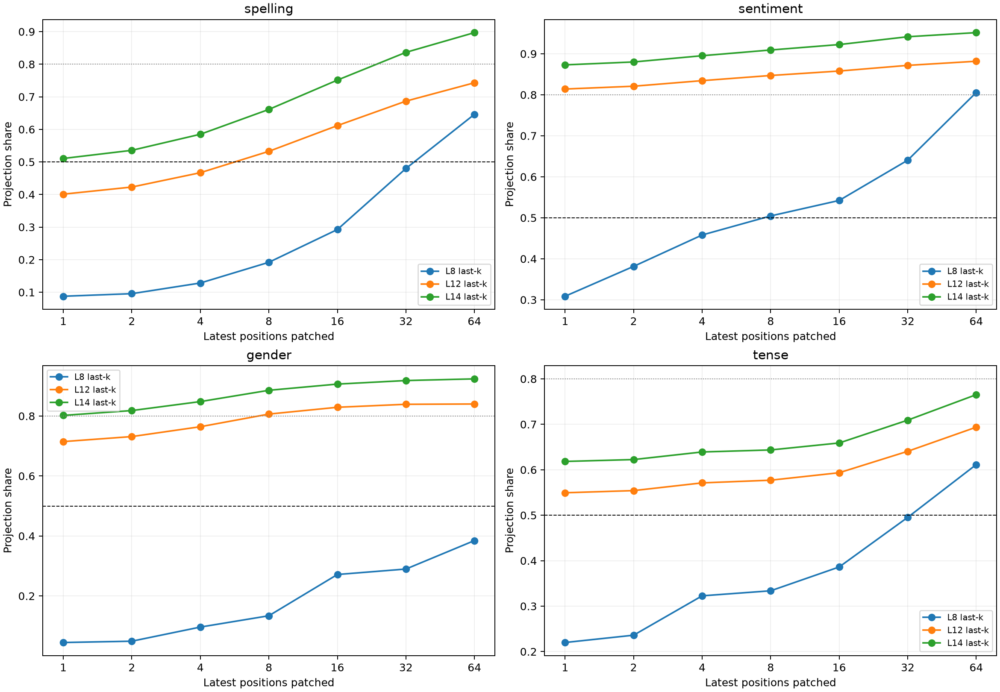

# Equal-budget spatial red team of semantic carriers

This reruns the natural semantic counterfactuals with matched spatial budgets. `last-k` patches the latest k causally eligible residual positions, `first-k` patches the earliest k positions beginning at the cue, and `spread-k` deterministically spreads k positions over the same cue-to-destination interval.

## Locked decisions

- **S0_exact_recomposition: supported.** Observed: `3.0428171157836914e-05`
- **S1_late_window_compression: not supported.** Observed: `{'spelling': 32, 'sentiment': 1, 'gender': 1, 'tense': None}`
- **S2_late_window_beats_early_window: supported.** Observed: `{'spelling': 0.5444342320001966, 'sentiment': 0.8184666570360907, 'gender': 0.5024169609636404, 'tense': 0.32246655856400297}`
- **S3_post_boundary_not_token_budget_artifact: not supported.** Observed: `{'spelling': {'median_post_count': 12.5, 'matched_k': 16, 'advantage': 0.1086554404365957}, 'sentiment': {'median_post_count': 12.0, 'matched_k': 8, 'advantage': 0.02459679217229105}, 'gender': {'median_post_count': 13.5, 'matched_k': 16, 'advantage': 0.0227843809323246}, 'tense': {'median_post_count': 16.0, 'matched_k': 16, 'advantage': -0.03938084686204868}}`

## Minimum latest-position window

| Family | L8 k@50% | L8 k@80% | L12 k@50% | L12 k@80% | L14 k@50% | L14 k@80% |
|---|---:|---:|---:|---:|---:|---:|
| spelling | 64 | — | 8 | — | 1 | 32 |
| sentiment | 8 | 64 | 1 | 1 | 1 | 1 |
| gender | — | — | 1 | 8 | 1 | 1 |
| tense | 64 | — | 1 | — | 1 | — |

## Layer-12 equal-budget comparison

| Family | Last 16 | First 16 | Spread 16 | Post-boundary | Post excl. destination |
|---|---:|---:|---:|---:|---:|
| spelling | 0.612 | 0.067 | 0.494 | 0.602 | 0.193 |
| sentiment | 0.858 | 0.039 | 0.842 | 0.849 | 0.037 |
| gender | 0.829 | 0.327 | 0.785 | 0.808 | 0.096 |
| tense | 0.593 | 0.271 | 0.634 | 0.595 | 0.043 |

## Interpretation guardrail

A successful latest-position window shows where a counterfactual state is sufficient for the original suffix, not a unique storage site. Window curves can mix destination compression with intermediate relay sites. The first/spread controls address token budget, but not every positional role; conclusions require the per-cell stability and held-out lexical-pair design already used here.
