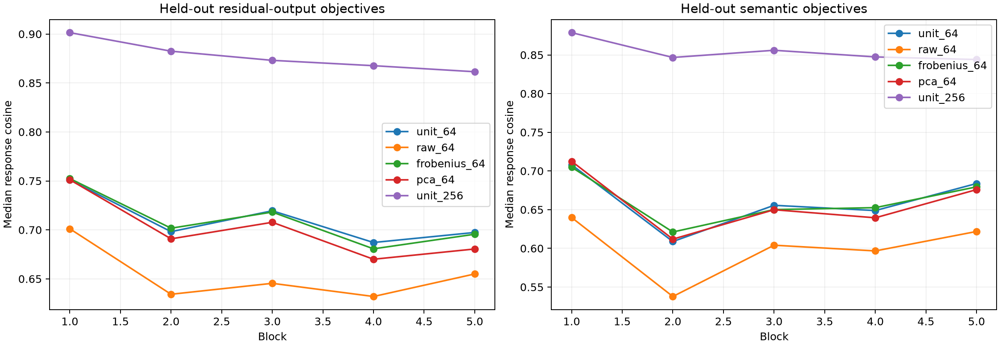

# Suffix-weighted early operator vocabulary

The exact bilinear operator tensor is weighted by real incoming adjoints obtained by transporting the stable residual-output subspace through the complete native suffix. Random tangent probes provide the second tensor leg. Bases are fit on disjoint FineWeb and evaluated on new residual objectives plus held-out human semantic objectives. Frobenius-operator modes and state PCA use the same state covariance and rank budgets.

## Locked hypotheses

- **T0_independent_q_sketches_recover_task_subspace: supported.**
- **T1_task_rank64_reconstructs_residual_objectives: not supported.**
- **T2_task_rank64_beats_frobenius: not supported.**
- **T3_task_rank64_beats_state_pca: not supported.**
- **T4_task_rank64_transfers_to_semantics: not supported.**
- **T5_task_rank256_is_high_fidelity: not supported.**
- **T6_adjoint_magnitude_changes_the_basis: supported.**

| Block | Unit stability | Raw/unit overlap | Residual unit64 / Frobenius / PCA | Residual unit256 | Semantic unit64 / Frobenius / PCA | Semantic unit256 |
|---:|---:|---:|---:|---:|---:|---:|
| 1 | 0.866 | 0.594 | 0.751/0.752/0.751 | 0.901 | 0.708/0.705/0.713 | 0.879 |
| 2 | 0.866 | 0.596 | 0.698/0.702/0.691 | 0.882 | 0.609/0.621/0.612 | 0.847 |
| 3 | 0.860 | 0.635 | 0.719/0.718/0.708 | 0.873 | 0.656/0.650/0.650 | 0.856 |
| 4 | 0.842 | 0.634 | 0.687/0.681/0.670 | 0.868 | 0.649/0.653/0.639 | 0.847 |
| 5 | 0.868 | 0.644 | 0.697/0.696/0.681 | 0.861 | 0.684/0.679/0.676 | 0.844 |

## Guardrails

This is a declared residual-output metric, not a universal operator ontology. The suffix-weighted basis uses native forward states and exact suffix adjoints on discovery data but no semantic labels. Transfer to the semantic panel tests reuse beyond its fitting objectives. Unit normalization asks for recurring directions; the raw variant allows high-gain contexts to dominate. Local response reconstruction is not yet a simultaneous multi-block causal replacement.
