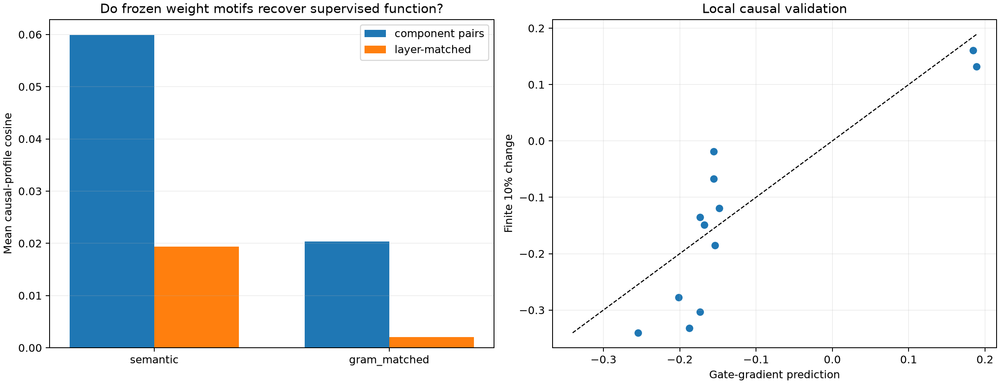

# Supervised anchors versus frozen weight motifs

The earlier 50-label run produced 32 competence-gated semantic targets, not 50 established circuits. Here those targets are used as external anchors for the already-frozen, label-blind attention-head components. Each head is fingerprinted by the signed derivative of the target logit contrast with respect to a multiplicative write gate on held-out positive sites.

## Locked results

- **A0_exact_forward: supported.**
- **A1_local_causal_measure: not supported.**
- **A2_supervised_profiles_replicate: supported.**
- **A3_weight_motifs_recover_supervised_function: not supported.**
- **A4_recovery_is_semantic: not supported.**

| Objective | Split geometry r | Median per-head split cosine | Component cosine | Layer-matched cosine | Enrichment | p |
|---|---:|---:|---:|---:|---:|---:|
| semantic | 0.507 | 0.483 | 0.060 | 0.019 | +0.041 | 0.0799 |
| gram_matched | 0.182 | 0.324 | 0.020 | 0.002 | +0.018 | 0.2065 |

The locked cluster test uses all within-component pairs, matching the wording fixed before evaluation. A stricter post-hoc direct-edge red team gives: semantic enrichment=+0.033, p=0.2016; gram_matched enrichment=+0.006, p=0.4156.

Finite 10% gate validation: r=0.860, sign agreement=1.000, median absolute relative error=0.278. All-one maximum logit error=0.000e+00.

## Component interpretations from supervised anchors

These names are post-hoc handles, not cluster definitions. Broad or semantically mixed anchor lists can be consistent with a reusable routing verb applied to different objects.

- Component 0 [L1H1, L3H6, L4H1, L9H7, L10H2, L15H1, L17H2], effective support 30.1: leading_space (0.250), all_caps (0.190), period (0.189), auxiliary (0.188), modal (0.167).
- Component 1 [L5H0, L5H7, L6H1, L9H8, L10H5], effective support 28.2: newline (0.282), leading_space (0.261), programming_keyword (0.213), preposition (0.201), suffix_ly (0.183).
- Component 2 [L4H5, L5H8, L6H3, L7H8, L11H2], effective support 27.8: period (0.259), determiner (0.233), long_piece (0.221), time_unit (0.203), suffix_s (0.197).
- Component 3 [L13H5, L14H7, L16H3], effective support 23.2: newline (0.416), period (0.281), dash (0.249), leading_space (0.225), programming_keyword (0.220).
- Component 4 [L10H8, L11H7, L12H6], effective support 22.1: newline (0.424), comma (0.322), punctuation (0.217), programming_keyword (0.210), conjunction (0.205).
- Component 5 [L7H3, L10H3, L15H3], effective support 26.1: determiner (0.319), suffix_ly (0.254), programming_keyword (0.245), pronoun (0.218), newline (0.216).
- Component 6 [L3H1, L4H2, L4H8], effective support 27.0: all_caps (0.325), determiner (0.232), word_continuation (0.207), suffix_ly (0.202), negation (0.200).
- Component 7 [L2H5, L3H5, L3H8], effective support 26.0: long_piece (0.268), newline (0.258), conjunction (0.243), period (0.227), negation (0.220).
- Component 8 [L0H7, L1H8, L2H7], effective support 27.1: period (0.325), opening_delimiter (0.267), non_ascii (0.255), preposition (0.189), capitalized (0.187).
- Component 9 [L17H6, L17H8], effective support 25.8: period (0.323), comma (0.317), suffix_ly (0.242), modal (0.240), word_continuation (0.224).
- Component 10 [L13H0, L14H4], effective support 24.1: capitalized (0.352), determiner (0.321), suffix_ly (0.306), newline (0.302), pronoun (0.214).
- Component 11 [L11H1, L12H7], effective support 21.6: modal (0.385), leading_space (0.302), conjunction (0.279), suffix_ly (0.275), negation (0.262).
- Component 12 [L10H4, L11H6], effective support 24.6: determiner (0.450), alphabetic (0.279), word_continuation (0.216), negation (0.207), pronoun (0.206).
- Component 13 [L9H6, L12H4], effective support 22.2: programming_keyword (0.314), long_piece (0.297), pronoun (0.279), lowercase (0.260), suffix_ion (0.257).
- Component 14 [L6H8, L10H7], effective support 19.0: alphabetic (0.445), non_ascii (0.382), newline (0.273), period (0.228), punctuation (0.202).
- Component 15 [L6H5, L6H7], effective support 21.7: newline (0.455), numeric (0.316), auxiliary (0.253), colon_semicolon (0.235), pronoun (0.202).
- Component 16 [L5H3, L9H1], effective support 23.0: modal (0.428), suffix_ed (0.314), period (0.286), suffix_ing (0.225), lowercase (0.222).
- Component 17 [L3H0, L4H0], effective support 26.6: preposition (0.276), modal (0.269), alphabetic (0.269), newline (0.234), long_piece (0.225).
- Component 18 [L1H7, L2H2], effective support 23.8: newline (0.334), colon_semicolon (0.323), pronoun (0.273), lowercase (0.248), suffix_ed (0.224).
- Component 19 [L1H5, L2H6], effective support 25.5: suffix_s (0.368), suffix_ed (0.284), programming_keyword (0.250), colon_semicolon (0.218), auxiliary (0.197).
- Component 20 [L1H3, L2H8], effective support 27.7: leading_space (0.274), capitalized (0.250), programming_keyword (0.240), suffix_ion (0.236), code_operator (0.226).

## What this does and does not validate

- Positive recovery means independently weight-similar heads also have similar local causal profiles over known model capabilities.
- Failure of semantic purity does not by itself falsify a shared computational verb: the same routing operation can act on unrelated semantic payloads.
- The gate derivative is local. The finite 10% test checks that it predicts nearby interventions; it is not a claim about deleting an entire head.
- The 32 labels are a deliberately limited human ontology and overlap lexically. They are silver-standard anchors, not the model's ground-truth latent variables.
