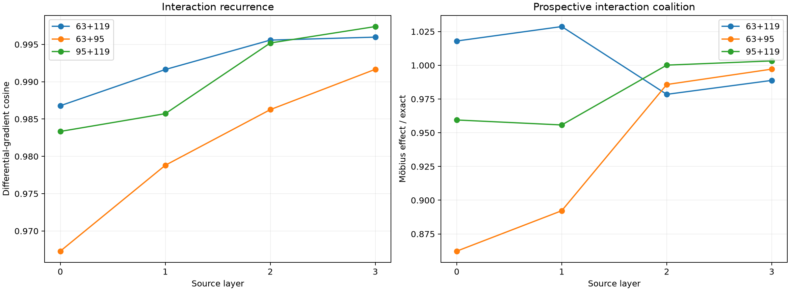

# Differential tensor program for two-token interactions

For each strength-balanced two-token edit, this assay asks how the earlier token's causal effect changes when the later token is present. Because causal masking prevents the later token from changing the earlier-position source product, subtracting the two suffix gradients isolates downstream contextual interaction. The finite endpoint is a Möbius difference: `(patch effect in B context) - (patch effect in base context)`.

Maximum differential all-attention error against independent autograd: `9.58e-06`.

## Locked hypotheses

- **I0_exact_differential_composition: supported.**
- **I1_near12_interaction_gradient: supported.**
- **I2_near12_interaction_tail: supported.**
- **I3_near12_recovers_interaction_support: supported.**
- **I4_exact_interaction_patch_has_finite_direction: supported.**
- **I5_near12_retains_interaction_effect: supported.**

| Layer | Pair | Near 8 cosine | Near 12 cosine/Q10 | Near 12 support | Exact finite direction | Near 12/exact Möbius effect |
|---:|---|---:|---:|---:|---:|---:|
| 0 | 63+119 | 0.832 | 0.987/0.966 | 0.803 | 1.000 | 1.018 |
| 0 | 63+95 | 0.745 | 0.967/0.886 | 0.695 | 1.000 | 0.862 |
| 0 | 95+119 | 0.814 | 0.983/0.935 | 0.803 | 1.000 | 0.959 |
| 1 | 63+119 | 0.929 | 0.992/0.953 | 0.829 | 1.000 | 1.029 |
| 1 | 63+95 | 0.880 | 0.979/0.887 | 0.742 | 1.000 | 0.892 |
| 1 | 95+119 | 0.897 | 0.986/0.977 | 0.778 | 1.000 | 0.956 |
| 2 | 63+119 | 0.958 | 0.996/0.980 | 0.855 | 1.000 | 0.978 |
| 2 | 63+95 | 0.907 | 0.986/0.937 | 0.803 | 1.000 | 0.986 |
| 2 | 95+119 | 0.920 | 0.995/0.982 | 0.882 | 1.000 | 1.000 |
| 3 | 63+119 | 0.973 | 0.996/0.989 | 0.883 | 1.000 | 0.989 |
| 3 | 63+95 | 0.940 | 0.992/0.961 | 0.869 | 1.000 | 0.997 |
| 3 | 95+119 | 0.960 | 0.997/0.987 | 0.910 | 1.000 | 1.003 |

## Guardrails

This is a local interaction explanation around two discrete edit worlds. Subtracting gradients is vulnerable to cancellation when the interaction is tiny, so absolute differential norms and finite Möbius effects are retained. A successful differential program explains contextual modulation of one source; it does not prove that a persistent conjunction feature exists in either source layer.
