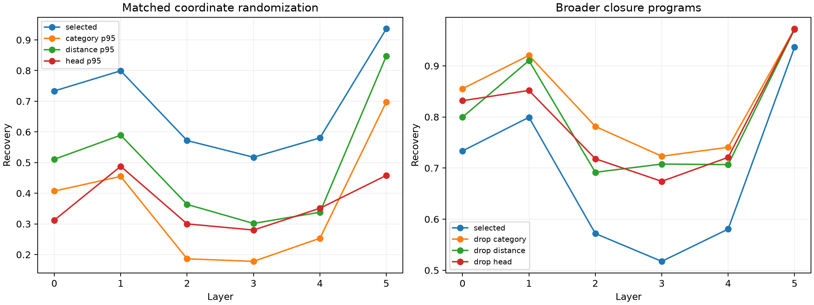

# Specificity red team for the typed attention-edge vocabulary

The typed vocabulary is reselected and evaluated on later disjoint FineWeb. Three controls preserve two coordinates of every selected type while randomizing the third: source category within head-distance, distance within head-category, or head within distance-category. Closure controls drop one condition and keep every matching edge of that broader type.

## Locked hypotheses

- **S0_typed_vocabulary_replicates: supported.**
- **S1_source_category_is_specific: supported.**
- **S2_distance_is_specific: supported.**
- **S3_head_is_specific: supported.**
- **S4_category_condition_excludes_harmful_edges: not supported.**
- **S5_distance_condition_excludes_harmful_edges: not supported.**

| Layer | Selected32 | Category random p95 / closure(size) | Distance random p95 / closure(size) | Head random p95 / closure(size) |
|---:|---:|---:|---:|---:|
| 0 | 0.734 | 0.407 / 0.855 (252) | 0.511 / 0.800 (112) | 0.312 / 0.832 (207) |
| 1 | 0.799 | 0.455 / 0.920 (231) | 0.589 / 0.910 (140) | 0.488 / 0.852 (153) |
| 2 | 0.572 | 0.186 / 0.781 (336) | 0.364 / 0.692 (105) | 0.300 / 0.718 (135) |
| 3 | 0.517 | 0.178 / 0.723 (294) | 0.302 / 0.708 (133) | 0.280 / 0.674 (135) |
| 4 | 0.581 | 0.253 / 0.741 (273) | 0.338 / 0.707 (119) | 0.351 / 0.721 (135) |
| 5 | 0.936 | 0.698 / 0.973 (168) | 0.847 / 0.971 (105) | 0.458 / 0.972 (270) |

## Guardrails

Randomized supports preserve group counts but can contain fewer unique types after collisions; categories also differ greatly in frequency. Closures use more executed edges and therefore test descriptive necessity, not equal-compute efficiency. If a closure improves recovery, the dropped coordinate was useful for ranking individual types but unnecessary for the broader executable program. All rankings remain linearized at native state; evaluation recomputes nonlinear RMSNorm exactly.
