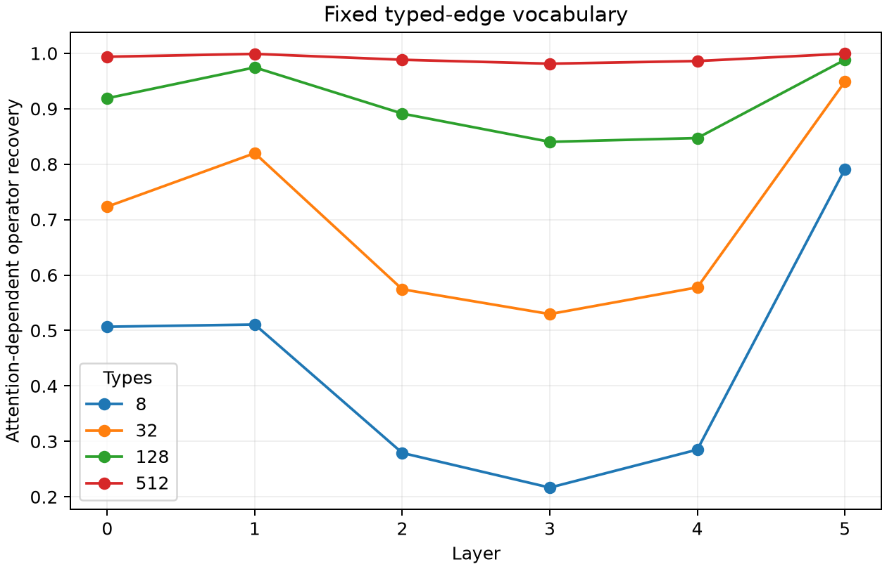

# Fixed vocabulary of typed attention edges

Every causal attention edge is assigned exactly one source-token category and one relative-distance bin, then paired with its native head. Discovery ranks these typed edges by their linearized effect on a weight-derived local operator sketch. Held-out evaluation keeps only the fixed selected types, recomputes RMSNorm exactly, and compares with equal-size random vocabularies.

Maximum partition/recomposition error: `1.32e-06`.

## Locked hypotheses

- **T0_typed_edges_partition_attention: supported.**
- **T1_top128_types_are_sufficient: supported.**
- **T2_top128_types_beat_random: supported.**
- **T3_top32_types_are_useful: supported.**
- **T4_middle_layers_require_broader_vocabularies: supported.**
- **T5_fixed_typed_vocabulary_generalizes: supported.**

| Layer | Active types | Recovery at 8/32/128/512 | Random p95 at 32/128 |
|---:|---:|---:|---:|
| 0 | 1260 | 0.507/0.723/0.919/0.994 | 0.072/0.277 |
| 1 | 1260 | 0.511/0.820/0.974/0.999 | 0.184/0.442 |
| 2 | 1260 | 0.279/0.574/0.891/0.988 | 0.118/0.213 |
| 3 | 1260 | 0.217/0.530/0.840/0.981 | 0.061/0.216 |
| 4 | 1260 | 0.285/0.578/0.847/0.986 | 0.082/0.220 |
| 5 | 1260 | 0.791/0.948/0.988/0.999 | 0.108/0.460 |

## Guardrails

The categories are a preregistered mutually exclusive human vocabulary, not learned latent features. Ranking uses a native-state linearization, while evaluation recomputes the nonlinear normalized state. Recovery concerns the attention-dependent local MLP operator, not final-token KL. Random supports are sampled from active types but are not matched for head, distance, or category counts. A positive result would establish a useful fixed routing vocabulary; it would not imply that each type has one output meaning.
