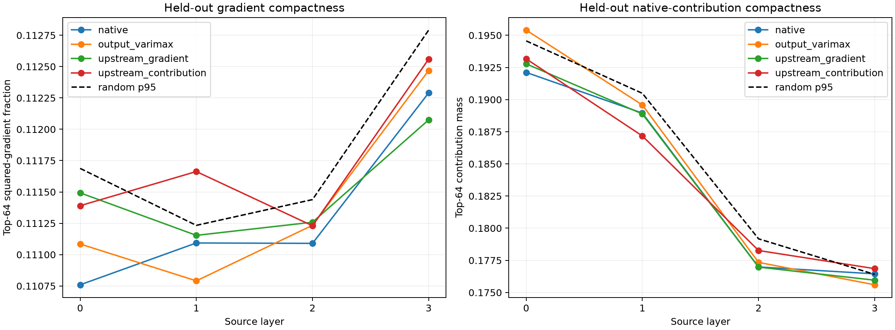

# Label-free discovery of upstream objective coordinates

Two orthogonal bases are fitted without semantic labels on discovery FineWeb: one maximizes sparsity of exact Layer-0--3 gradient programs, and one maximizes sparsity of native activation-weighted contributions. Every cell and objective is RMS-normalized before fitting. Bases are frozen before disjoint FineWeb evaluation and compared with the output-varimax basis and 32 matched rotations of the identical rank-16 subspace.

## Locked hypotheses

- **U0_gradient_basis_transfers: not supported.**
- **U1_contribution_basis_transfers: not supported.**
- **U2_upstream_coordinates_are_reproducible: not supported.**
- **U3_one_basis_serves_both_upstream_metrics: not supported.**
- **U4_upstream_basis_is_distinct_from_output_basis: supported.**
- **U5_upstream_sparsity_implies_semantics: not supported.**

Split-half coordinate overlap: gradient **0.759**, contribution **0.678**.
Overlap with output-varimax: gradient **0.671**, contribution **0.607**.
Vocabulary semantic AUROC: gradient **0.815**, contribution **0.819**, random p95 **0.837**.
Fitted-axis global excess kurtosis, discovery/evaluation: gradient **1.922/1.554**; contribution **326.080/385.897**.

| Layer | Basis | Discovery gradient/contribution | Evaluation gradient/contribution |
|---:|---|---:|---:|
| 0 | native | 0.111/0.194 | 0.111/0.192 |
| 0 | output_varimax | 0.111/0.196 | 0.111/0.195 |
| 0 | upstream_gradient | 0.111/0.195 | 0.111/0.193 |
| 0 | upstream_contribution | 0.111/0.194 | 0.111/0.193 |
| 0 | random p95 | — | 0.112/0.195 |
| 1 | native | 0.112/0.191 | 0.111/0.189 |
| 1 | output_varimax | 0.112/0.192 | 0.111/0.190 |
| 1 | upstream_gradient | 0.112/0.192 | 0.111/0.189 |
| 1 | upstream_contribution | 0.112/0.192 | 0.112/0.187 |
| 1 | random p95 | — | 0.111/0.190 |
| 2 | native | 0.113/0.181 | 0.111/0.177 |
| 2 | output_varimax | 0.113/0.182 | 0.111/0.177 |
| 2 | upstream_gradient | 0.113/0.181 | 0.111/0.177 |
| 2 | upstream_contribution | 0.113/0.181 | 0.111/0.178 |
| 2 | random p95 | — | 0.111/0.179 |
| 3 | native | 0.113/0.182 | 0.112/0.176 |
| 3 | output_varimax | 0.113/0.183 | 0.112/0.176 |
| 3 | upstream_gradient | 0.113/0.182 | 0.112/0.176 |
| 3 | upstream_contribution | 0.113/0.183 | 0.113/0.177 |
| 3 | random p95 | — | 0.113/0.176 |

## Post-hoc rare-event audit

Each axis receives a per-site score equal to its largest native-channel magnitude divided by its RMS channel magnitude. Simple current-token, next-token, absolute-position, and source-layer predicates are selected on discovery rows only and frozen for evaluation.

| Event family | Gradient-basis AUROC | Contribution-basis AUROC | Random p95 |
|---|---:|---:|---:|
| gradient | 0.568 | 0.532 | 0.552 |
| contribution | 0.535 | 0.541 | 0.568 |

### Selected gradient-axis event labels

| Axis | Gradient fit | Contribution fit |
|---:|---|---|
| 0 | `current:long_piece` (0.39) | `current:capitalized` (0.67) |
| 1 | `current:capitalized` (0.68) | `current:lowercase` (0.56) |
| 2 | `position:127` (0.46) | `current:capitalized` (0.59) |
| 3 | `layer:2` (0.57) | `current:capitalized` (0.44) |
| 4 | `current:long_piece` (0.57) | `current:capitalized` (0.50) |
| 5 | `current:word_continuation` (0.52) | `next:capitalized` (0.54) |
| 6 | `position:127` (0.48) | `current:capitalized` (0.47) |
| 7 | `current:capitalized` (0.58) | `current:lowercase` (0.63) |
| 8 | `current:word_continuation` (0.43) | `current:capitalized` (0.38) |
| 9 | `layer:2` (0.57) | `current:capitalized` (0.63) |
| 10 | `current:long_piece` (0.51) | `current:capitalized` (0.64) |
| 11 | `layer:2` (0.58) | `current:capitalized` (0.53) |
| 12 | `current:capitalized` (0.60) | `current:capitalized` (0.53) |
| 13 | `next:punctuation` (0.57) | `current:capitalized` (0.60) |
| 14 | `layer:1` (0.46) | `next:capitalized` (0.54) |
| 15 | `current:capitalized` (0.57) | `current:capitalized` (0.53) |

## Guardrails

This is an unsupervised coordinate search inside a pre-existing output subspace, not discovery of the subspace itself. Transfer and split-half stability distinguish reusable axes from a discovery-set sparsity fit. Semantic labels are evaluated only after all rotations are frozen. Global kurtosis can reflect rare context-channel events while per-example channel support remains broad; these are different definitions of sparsity.
