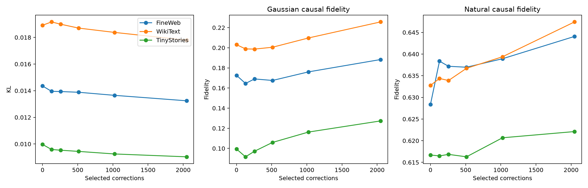

# Rank curve for direct-tensor corrections

Each selected component replaces one language CP term by a two-term 0.8/0.2 blend, so the literal upper-bound rank is `2048 + selected_count`.

| Selected corrections | Rank upper bound | Score energy | FineWeb KL | FW Gaussian | FW natural |
|---:|---:|---:|---:|---:|---:|
| 0 | 2048 | 0.000 | 0.0144 | 0.173 | 0.628 |
| 128 | 2176 | 0.226 | 0.0140 | 0.165 | 0.638 |
| 256 | 2304 | 0.322 | 0.0139 | 0.169 | 0.637 |
| 512 | 2560 | 0.473 | 0.0139 | 0.168 | 0.637 |
| 1024 | 3072 | 0.703 | 0.0137 | 0.176 | 0.639 |
| 2048 | 4096 | 1.000 | 0.0132 | 0.188 | 0.644 |

## Random-selection control

At 512 corrections, energy-ranked selection gives FineWeb KL 0.0139, versus 0.0141 for random selection.

A steep early curve supports a sparse high-sensitivity correction. A near-linear curve supports broadly distributed complementary rank. Selection used FineWeb training activations; cross-corpus results in the JSON are transfer tests.

Raw results: `blend_rank_curve_results.json`.
