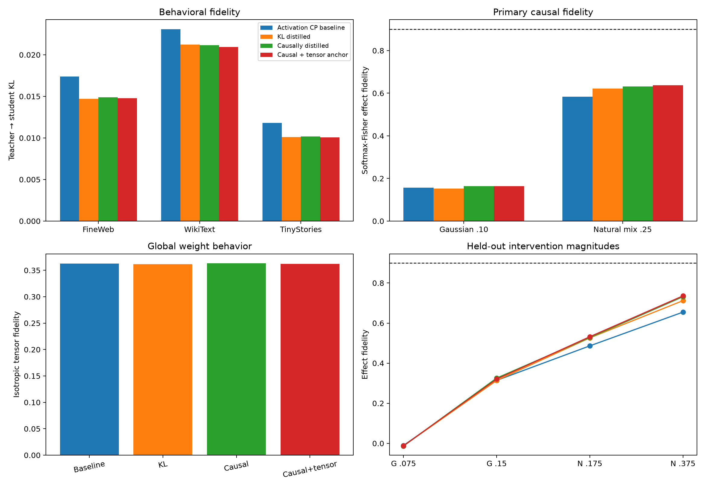

# Causal CP distillation results — optimizer-corrected R2

## Outcome

- **H1_kl_behavior: supported.**
- **H2_causal_training: supported.**
- **H3_tensor_anchor: not supported.**
- **H4_scale_transfer: not supported.**
- **H5_causal_gate: not supported.**

## Behavior

| Model | FineWeb KL | WikiText KL | TinyStories KL |
|---|---:|---:|---:|
| Activation CP baseline | 0.0174 | 0.0231 | 0.0118 |
| KL distilled | 0.0147 | 0.0212 | 0.0101 |
| Causally distilled | 0.0149 | 0.0212 | 0.0102 |
| Causal + tensor anchor | 0.0148 | 0.0209 | 0.0101 |

## Causal fidelity

| Model | Gaussian .10 fidelity | Gaussian cosine | Natural .25 fidelity | Natural cosine |
|---|---:|---:|---:|---:|
| Activation CP baseline | 0.157 | 0.557 | 0.584 | 0.807 |
| KL distilled | 0.152 | 0.563 | 0.621 | 0.821 |
| Causally distilled | 0.163 | 0.564 | 0.632 | 0.824 |
| Causal + tensor anchor | 0.164 | 0.565 | 0.637 | 0.824 |

## Global/local tradeoff

| Model | Tensor fidelity | FineWeb write fidelity | Factor cosine to baseline | Activation CKA |
|---|---:|---:|---:|---:|
| Activation CP baseline | 0.363 | 0.870 | 1.000 | 1.000 |
| KL distilled | 0.362 | 0.871 | 1.000 | 0.999 |
| Causally distilled | 0.363 | 0.872 | 1.000 | 0.999 |
| Causal + tensor anchor | 0.362 | 0.872 | 1.000 | 0.999 |

## Red-team interpretation

- Training on a causal metric can improve that metric without proving that the learned factors are canonical or human-semantic.
- Held-out magnitudes and OOD corpora test interpolation and distribution transfer, but not unrelated intervention families or other layers.
- All variants share one architecture and initialization. This is an objective comparison, not independent rediscovery.
- The teacher itself defines the distillation target; agreement does not explain why the teacher computes the behavior.

Raw results: `causal_distillation_r2_results.json`.
